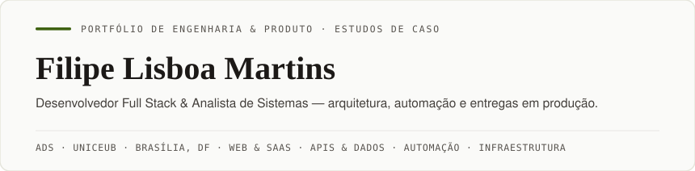
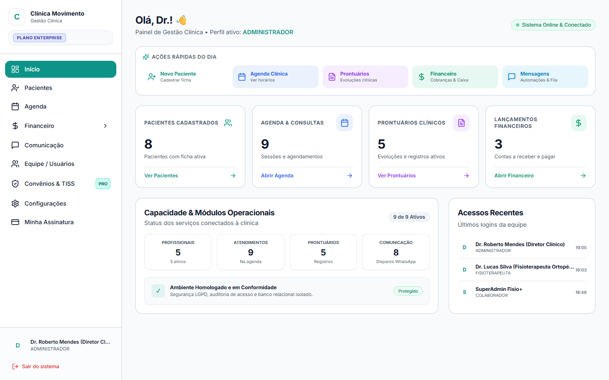
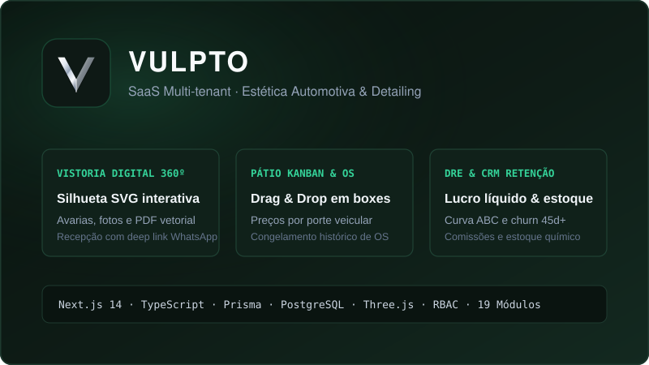
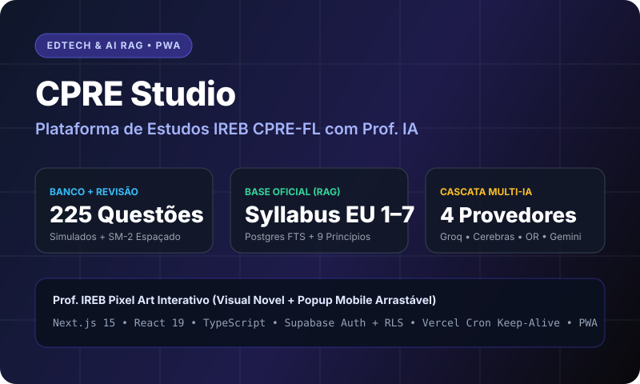
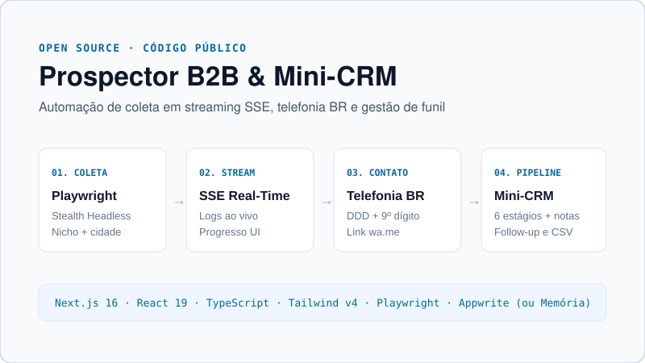
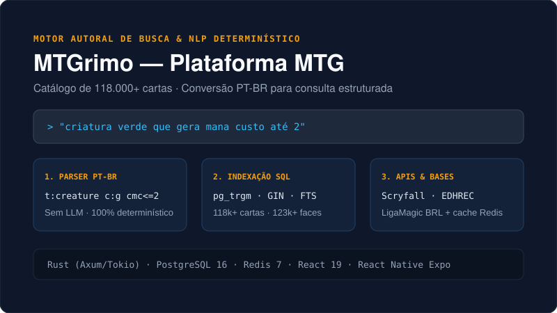
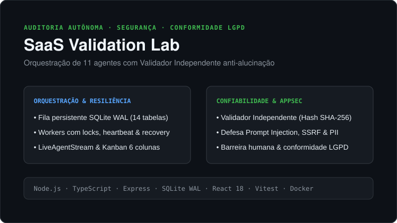
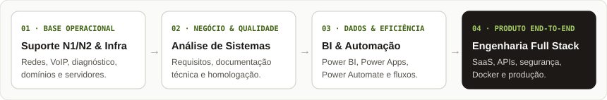
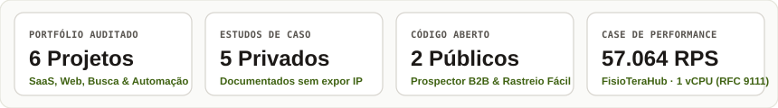

  <picture>
    <source media="(prefers-color-scheme: dark)" srcset="./assets/hero-dark.svg">
    <source media="(prefers-color-scheme: light)" srcset="./assets/hero-light.svg">
    
  </picture>

<a href="#01-sobre-mim">01&nbsp;&middot;&nbsp;Sobre</a> &nbsp;&middot;&nbsp; <a href="#02-projetos-principais">02&nbsp;&middot;&nbsp;Projetos</a> &nbsp;&middot;&nbsp; <a href="#04-estudos-de-caso">03&nbsp;&middot;&nbsp;Estudos&nbsp;de&nbsp;Caso</a> &nbsp;&middot;&nbsp; <a href="#05-competências-técnicas">04&nbsp;&middot;&nbsp;Competências</a> &nbsp;&middot;&nbsp; <a href="#06-conexão-de-experiência">05&nbsp;&middot;&nbsp;Trajetória</a> &nbsp;&middot;&nbsp; <a href="#08-vamos-conversar">06&nbsp;&middot;&nbsp;Contato</a>

---

## 01. Sobre Mim

Sou **Filipe Lisboa Martins**, graduado em **Análise e Desenvolvimento de Sistemas pelo UniCEUB**. Ao longo da minha trajetória passei por frentes que se complementam diretamente na criação de software: **suporte técnico N1/N2, redes e telefonia VoIP**; **análise de negócios, requisitos e homologação**; **dados e automação (Power BI, Power Apps e Power Automate)**; e **desenvolvimento Full Stack** em produção.

Essa base multidisciplinar faz diferença prática no resultado final: antes de escolher frameworks, entendo o fluxo operacional, as exigências legais e o custo de manutenção — entregando sistemas enxutos, auditáveis e pensados para quem realmente vai usá-los todos os dias.

---

## 02. Projetos Principais

<table>
  <tr>
    <td width="46%" valign="top">
      
        
      
    </td>
    <td width="54%" valign="top">
      <strong>CASE 01 &middot; HEALTHTECH SAAS MULTI-TENANT &middot; PRIVADO</strong>
      <h3>FisioTeraHub</h3>
      
<strong>O Problema:</strong> clínicas de fisioterapia divididas entre planilhas, prontuários em papel e sistemas rígidos sem adequação regulatória brasileira.

      
<strong>A Solução:</strong> plataforma SaaS multi-tenant com <strong>22 módulos backend e 38 modelos relacionais</strong> cobrindo prontuário longitudinal imutável (COFFITO/LGPD), agenda com Kanban, portal do paciente, convênios <strong>ANS TISS 4.01 / TUSS</strong> e financeiro completo (Pix, boletos FEBRABAN e assinaturas Asaas).

      
<strong>Evidência de Engenharia:</strong> em teste de carga real (Loader.io) sobre VPS de 1 vCPU / 2 GB RAM, a adoção de Edge Microcaching (RFC 9111 + Cloudflare Origin Shielding) elevou a vazão de ~2.508 para <strong>57.064 RPS</strong> (99,997% cache hit e 68 ms de latência média).

      
<code>Node.js</code> <code>Express</code> <code>TypeScript</code> <code>Prisma</code> <code>PostgreSQL 16</code> <code>React 18</code> <code>Docker</code> <code>Nginx</code>

      
<a href="./cases/fisioterahub.md"><strong>Ler Estudo de Caso Completo →</strong></a> &nbsp;&middot;&nbsp; <a href="https://fisioterahub.com"><strong>Acessar Plataforma →</strong></a>

    </td>
  </tr>
</table>

 

<table>
  <tr>
    <td width="46%" valign="top">
      
    </td>
    <td width="54%" valign="top">
      <strong>CASE 02 &middot; ERP &amp; SAAS VERTICAL &middot; PRIVADO</strong>
      <h3>Vulpto — Estética Automotiva &amp; Detailing</h3>
      
<strong>O Problema:</strong> estúdios de estética automotiva sem rastreabilidade de avarias na recepção, controle de pátio nem visibilidade de margem líquida real.

      
<strong>A Solução:</strong> SaaS multi-tenant com <strong>19 módulos</strong> e RBAC (<code>ADMIN</code> vs <code>OPERATOR</code>): vistoria digital 360º com marcação de avarias em SVG e fotos, matriz de preços por porte veicular, orçamentos em PDF vetorial, Kanban de boxes, <strong>DRE gerencial em tempo real</strong>, estoque químico com custo médio ponderado e CRM de retenção (Curva ABC, dias de chuva e alerta de churn 45d+).

      
<code>Next.js 14</code> <code>TypeScript</code> <code>Prisma</code> <code>PostgreSQL</code> <code>Three.js</code> <code>Redis</code> <code>Zod</code> <code>Docker</code>

      
<a href="./cases/vulpto.md"><strong>Ler Estudo de Caso Completo →</strong></a> &nbsp;&middot;&nbsp; <a href="https://vulpto.duckdns.org/"><strong>Acessar Plataforma →</strong></a>

    </td>
  </tr>
</table>

 

<table>
  <tr>
    <td width="46%" valign="top">
      <a href="./cases/cia-do-lacre.md">
        <picture>
          <source media="(prefers-color-scheme: dark)" srcset="./assets/cover-cia-dark.svg">
          <source media="(prefers-color-scheme: light)" srcset="./assets/cover-cia-light.svg">
          
        </picture>
      </a>
    </td>
    <td width="54%" valign="top">
      <strong>CASE 03 &middot; INSTITUCIONAL, UX INCLUSIVO &amp; LEI 13.019/2014 &middot; PRIVADO</strong>
      <h3>Associação Cia do Lacre</h3>
      
<strong>O Contexto:</strong> reconstrução completa da presença digital da associação de moda e artesanato sustentável fundada em 1997 em Brasília-DF.

      
<strong>A Solução:</strong> portal editorial com identidade cromática oficial (<em>Olive System</em>), 10 seções institucionais, <strong>Portal da Transparência MROSC (Ministério da Cultura)</strong> com visualizador embutido para 18 relatórios oficiais sem abrir novas abas, Termo de Voluntariado (Lei 9.608/1998) e <strong>Painel Administrativo inclusivo de 10 telas</strong> projetado para autonomia de artesãs sem perfil técnico.

      
<code>React 19</code> <code>Vite 8</code> <code>Tailwind CSS</code> <code>Supabase</code> <code>GSAP</code> <code>Embla</code> <code>Vercel</code>

      
<a href="./cases/cia-do-lacre.md"><strong>Ler Estudo de Caso Completo →</strong></a> &nbsp;&middot;&nbsp; <a href="https://cia-do-lacre.vercel.app/"><strong>Acessar Site Oficial →</strong></a>

    </td>
  </tr>
</table>

 

<table>
  <tr>
    <td width="46%" valign="top">
      
    </td>
    <td width="54%" valign="top">
      <strong>CASE 04 &middot; EDTECH, AI RAG &amp; MOBILE PWA &middot; PRIVADO</strong>
      <h3>CPRE Studio — IREB CPRE-FL com Prof. IA</h3>
      
<strong>O Problema:</strong> preparação para a certificação IREB CPRE Foundation Level dispersa em PDFs estáticos, sem revisão espaçada, sem simulados realistas nem tutoria conceitual sem spoiler.

      
<strong>A Solução:</strong> plataforma PWA multiusuário (desktop e celular) com <strong>225 questões validadas</strong>, simulados cronometrados, revisão espaçada (SM-2), <strong>Prof. IREB em pixel art animado</strong> (popup arrastável e redimensionável no mobile), <strong>RAG sobre o Syllabus oficial IREB v3.x (EU 1–7)</strong> no PostgreSQL/Supabase com FTS em português, <strong>cascata Multi-IA gratuita</strong> (Groq → Cerebras → OpenRouter <code>:free</code> → Gemini), skill pedagógica parametrizável, Supabase Auth + RLS e cron Keep-Alive na Vercel.

      
<code>Next.js 15</code> <code>React 19</code> <code>TypeScript</code> <code>Supabase</code> <code>PostgreSQL FTS</code> <code>RAG</code> <code>PWA</code> <code>Vercel</code>

      
<a href="./cases/ireb-cpre-studio.md"><strong>Ler Estudo de Caso Completo →</strong></a>

    </td>
  </tr>
</table>

---

## 03. Engenharia, Busca e Automação

<table>
  <tr>
    <td width="33%" valign="top">
      <a href="https://github.com/FlipLM/Prospector">
        <picture>
          <source media="(prefers-color-scheme: dark)" srcset="./assets/cover-prospector-dark.svg">
          <source media="(prefers-color-scheme: light)" srcset="./assets/cover-prospector-light.svg">
          
        </picture>
      </a>
        
      
      <h4>Prospector B2B</h4>
      
Automação Playwright com streaming <strong>SSE em tempo real</strong>, validação de WhatsApp BR (DDD e 9º dígito), Mini-CRM com agenda de follow-ups e fallback local em memória.

      
<code>Next.js 16</code> <code>React 19</code> <code>Playwright</code> <code>Appwrite</code>

      
<a href="https://github.com/FlipLM/Prospector"><strong>Ver Repositório Público →</strong></a>

    </td>
    <td width="33%" valign="top">
      
        
      <picture>
        <source media="(prefers-color-scheme: dark)" srcset="./assets/badge-case-dark.svg">
        <source media="(prefers-color-scheme: light)" srcset="./assets/badge-case-light.svg">
        
      </picture>
      <h4>MTGrimo</h4>
      
<strong>Minha atuação:</strong> desenvolvimento do mecanismo autoral de busca por cartas (118k+ cartas), integração com APIs de bases de dados e conversão determinística de linguagem natural PT-BR.

      
<code>Rust/Axum</code> <code>PostgreSQL 16</code> <code>Redis</code> <code>React 19</code>

      
<a href="./cases/mtgrimo.md"><strong>Ler Estudo de Caso →</strong></a> &nbsp;&middot;&nbsp; <a href="https://mtgrimo.com/"><strong>Acessar Site →</strong></a>

    </td>
    <td width="33%" valign="top">
      
        
      <picture>
        <source media="(prefers-color-scheme: dark)" srcset="./assets/badge-case-dark.svg">
        <source media="(prefers-color-scheme: light)" srcset="./assets/badge-case-light.svg">
        
      </picture>
      <h4>SaaS Validation Lab</h4>
      
Orquestrador autônomo de auditoria QA/segurança/LGPD com fila SQLite WAL, 11 agentes especializados, defesa Prompt Injection/SSRF e <strong>Validador Independente SHA-256</strong>.

      
<code>Node.js</code> <code>Express</code> <code>SQLite WAL</code> <code>Vitest</code>

      
<a href="./cases/saas-validation-lab.md"><strong>Ler Estudo de Caso →</strong></a>

    </td>
  </tr>
</table>

<strong>Complemento open-source mobile:</strong> <a href="https://github.com/FlipLM/RastreioFacil"><strong>RastreioFácil</strong></a> (<code>Flutter / Dart</code>) — aplicativo acadêmico para cadastro local de encomendas (<code>Provider</code> + <code>SharedPreferences</code>) e acesso rápido a transportadoras via <code>WebView</code>.

---

## 04. Estudos de Caso

Projetos privados de valor comercial, institucional ou colaborativo documentados sem exposição de código proprietário, credenciais ou dados de clientes:

| Projeto | Domínio | Diferencial Técnico Comprovado | Estudo de Caso | Demonstração |
| :--- | :--- | :--- | :--- | :--- |
| **FisioTeraHub** | HealthTech / SaaS | Multi-tenant, ANS TISS 4.01/TUSS, COFFITO/LGPD e **57.064 RPS** em 1 vCPU | [`cases/fisioterahub.md`](./cases/fisioterahub.md) | [fisioterahub.com](https://fisioterahub.com) |
| **Vulpto** | ERP / Detailing | Vistoria 360º SVG, DRE gerencial real, estoque químico, RBAC e CRM Curva ABC | [`cases/vulpto.md`](./cases/vulpto.md) | [vulpto.duckdns.org](https://vulpto.duckdns.org/) |
| **Associação Cia do Lacre** | Terceiro Setor | Transparência MROSC (18 PDFs embutidos — Ministério da Cultura) e CMS inclusivo | [`cases/cia-do-lacre.md`](./cases/cia-do-lacre.md) | [cia-do-lacre.vercel.app](https://cia-do-lacre.vercel.app/) |
| **CPRE Studio (IREB)** | EdTech / AI RAG | 225 questões, RAG Syllabus oficial (Postgres FTS), cascata Multi-IA, Auth+RLS e PWA | [`cases/ireb-cpre-studio.md`](./cases/ireb-cpre-studio.md) | *Ambiente privado* |
| **MTGrimo** | Search & NLP | Mecanismo autoral de busca de cartas, APIs de bases de dados e parser PT-BR determinístico | [`cases/mtgrimo.md`](./cases/mtgrimo.md) | [mtgrimo.com](https://mtgrimo.com/) |
| **SaaS Validation Lab** | AppSec & Governança IA | Orquestrador daemon SQLite WAL, 11 agentes, defesa SSRF/Prompt Injection e Validador SHA-256 | [`cases/saas-validation-lab.md`](./cases/saas-validation-lab.md) | *Ambiente privado* |

---

## 05. Competências Técnicas

<table>
  <tr>
    <td width="33%" valign="top">
      <strong>Desenvolvimento Web</strong> 
      TypeScript &middot; JavaScript &middot; React 18/19 &middot; Next.js 14/16 &middot; Vite &middot; Tailwind CSS &middot; TanStack Query &middot; Flutter/Dart
    </td>
    <td width="33%" valign="top">
      <strong>Backend &amp; APIs</strong> 
      Node.js &middot; Express &middot; Route Handlers &middot; REST &middot; SSE &middot; Prisma ORM &middot; Zod &middot; JWT &middot; OAuth2 &middot; RBAC
    </td>
    <td width="33%" valign="top">
      <strong>Dados &amp; Persistência</strong> 
      PostgreSQL &middot; SQLite WAL &middot; Supabase &middot; Appwrite &middot; Redis &middot; Modelagem Multi-tenant
    </td>
  </tr>
  <tr>
    <td width="33%" valign="top">
      <strong>Automação &amp; BI</strong> 
      Power BI &middot; Power Apps &middot; Power Automate &middot; Playwright &middot; Dashboards &amp; Fluxos Empresariais
    </td>
    <td width="33%" valign="top">
      <strong>Infraestrutura &amp; Redes</strong> 
      Docker &middot; Compose &middot; Nginx &middot; Coolify &middot; Vercel &middot; Cloudflare &middot; Redes &middot; VoIP &middot; Suporte N1/N2
    </td>
    <td width="33%" valign="top">
      <strong>Negócios &amp; Qualidade</strong> 
      Requisitos &middot; Homologação &middot; Documentação &middot; Vitest &middot; Locust &middot; LGPD &middot; TISS &middot; MROSC
    </td>
  </tr>
</table>

---

## 06. Conexão de Experiência

  <picture>
    <source media="(prefers-color-scheme: dark)" srcset="./assets/career-flow-dark.svg">
    <source media="(prefers-color-scheme: light)" srcset="./assets/career-flow-light.svg">
    
  </picture>

---

## 07. Panorama do Portfólio

  <picture>
    <source media="(prefers-color-scheme: dark)" srcset="./assets/panorama-dark.svg">
    <source media="(prefers-color-scheme: light)" srcset="./assets/panorama-light.svg">
    
  </picture>

---

## 08. Vamos Conversar

Disponível para oportunidades de contratação, consultoria técnica e desenvolvimento de sistemas sob demanda.

&nbsp;&nbsp;<a href="mailto:filipelisboalct@gmail.com"><picture><source media="(prefers-color-scheme: dark)" srcset="./assets/btn-email-dark.svg"><source media="(prefers-color-scheme: light)" srcset="./assets/btn-email-light.svg"></picture></a>

