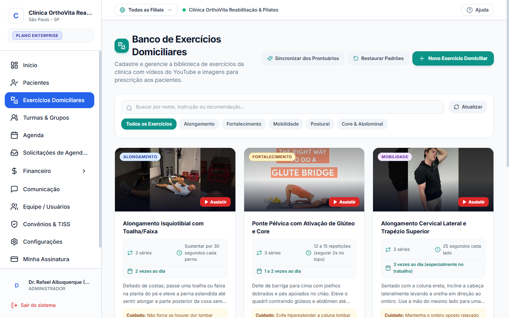
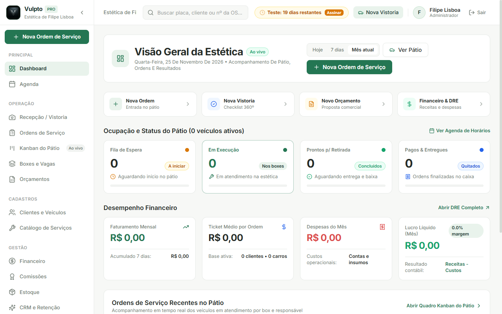
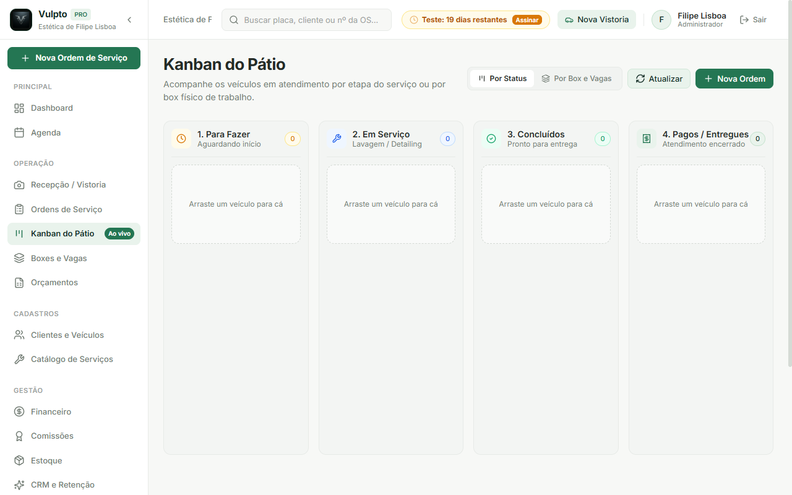
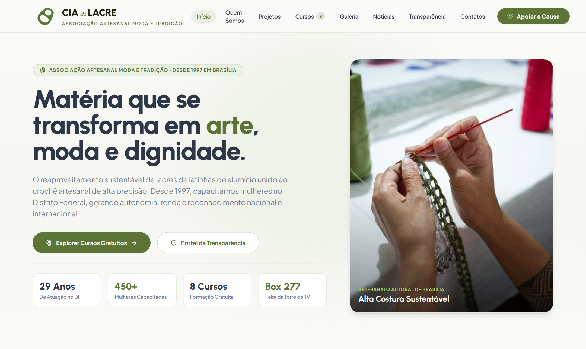
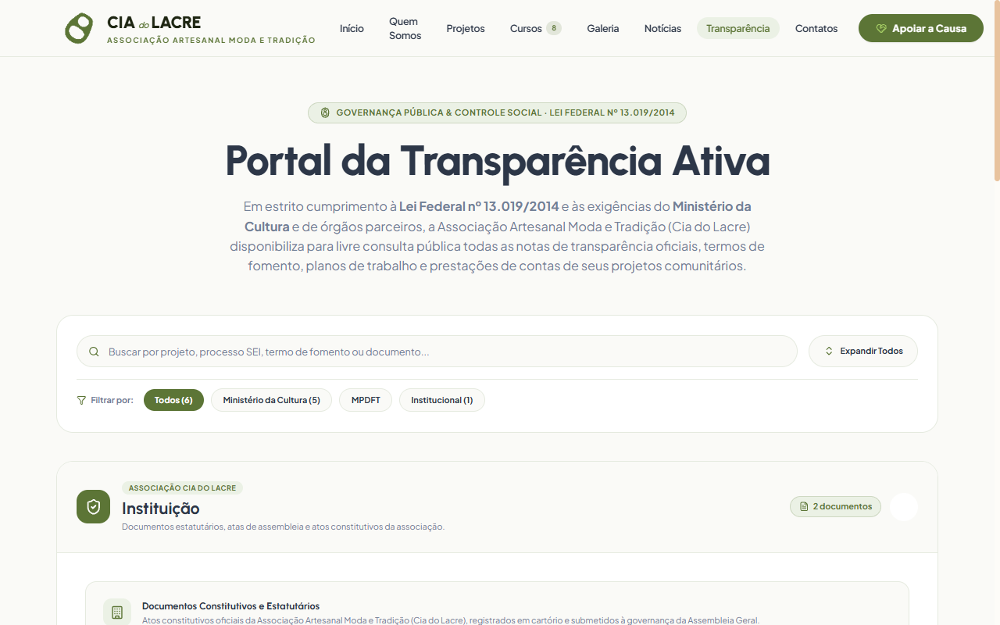
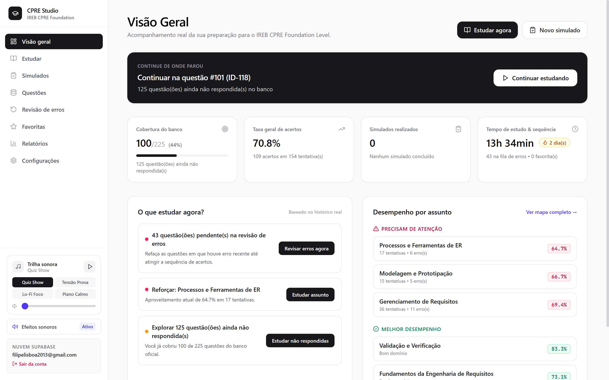
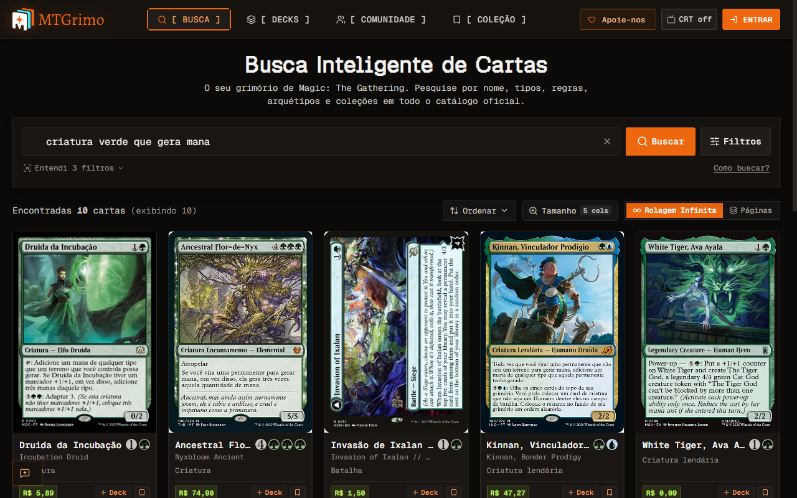
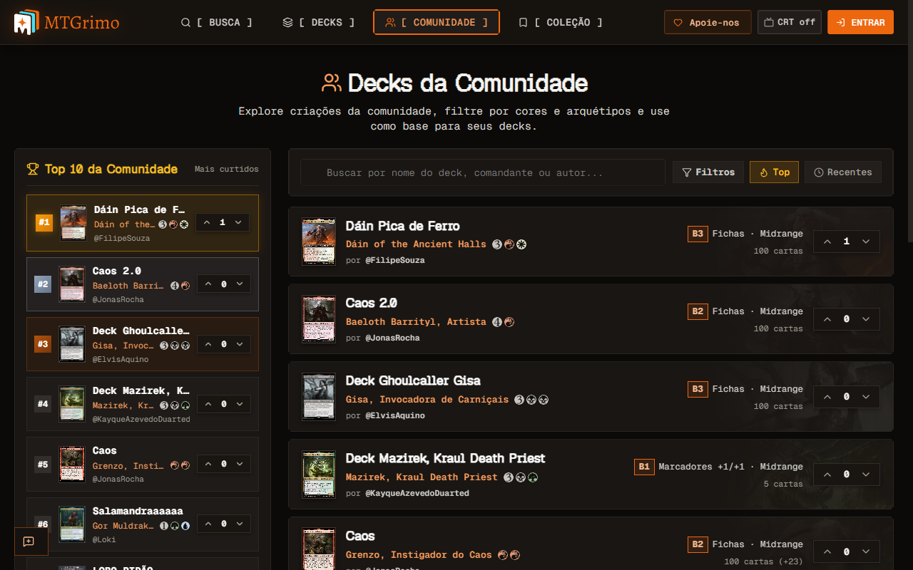
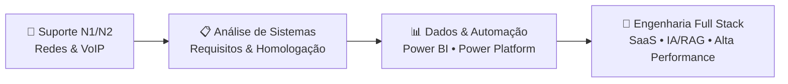

# 👋 Filipe Lisboa Martins

### Desenvolvedor Full Stack & Analista de Sistemas

*Construindo sistemas reais, auditáveis e de alta performance — de SaaS multi-tenant (57k RPS em 1 vCPU) a plataformas EdTech com IA, RAG e RPG Local-First.*

  
  
  

  <a href="#01-sobre-mim">01 · Sobre</a> &nbsp;·&nbsp;
  <a href="#02-projetos-principais">02 · Projetos</a> &nbsp;·&nbsp;
  <a href="#03-engenharia-busca-e-automação">03 · Engenharia &amp; IA</a> &nbsp;·&nbsp;
  <a href="#04-estudos-de-caso">04 · Estudos de Caso</a> &nbsp;·&nbsp;
  <a href="#05-competências-técnicas">05 · Stack</a> &nbsp;·&nbsp;
  <a href="#06-trajetória-integrada">06 · Trajetória</a>

---

## 01. Sobre Mim

Sou **Filipe Lisboa Martins**, graduado em **Análise e Desenvolvimento de Sistemas pelo UniCEUB**. Ao longo da minha trajetória passei por frentes que se complementam diretamente na criação de software: **suporte técnico N1/N2, redes e telefonia VoIP**; **análise de negócios, requisitos e homologação**; **dados e automação (Power BI, Power Apps e Power Automate)**; e **desenvolvimento Full Stack** em produção.

Essa base multidisciplinar faz diferença prática no resultado final: antes de escolher frameworks, entendo o fluxo operacional, as exigências legais e o custo de manutenção — entregando sistemas enxutos, auditáveis e pensados para quem realmente vai usá-los todos os dias.

---

## 02. Projetos Principais

> Todos os projetos abaixo exibem **exclusivamente prints reais** de ambientes em produção/demonstração — zero mockups ou imagens geradas.

<table>
  <tr>
    <td width="46%" valign="top">
      
        
      
    </td>
    <td width="54%" valign="top">
      <strong>CASE 01 &middot; HEALTHTECH SAAS MULTI-TENANT &middot; PRIVADO</strong>
      <h3>🩺 FisioTeraHub</h3>
      
<strong>O Problema:</strong> clínicas de fisioterapia divididas entre planilhas, prontuários em papel e sistemas rígidos sem adequação regulatória brasileira.

      
<strong>A Solução:</strong> plataforma SaaS multi-tenant com <strong>22 módulos backend e 38 modelos relacionais</strong> cobrindo prontuário longitudinal imutável (COFFITO/LGPD), agenda clínica, turmas de Pilates, banco de exercícios domiciliares com vídeos, convênios <strong>ANS TISS 4.01 / TUSS</strong> e financeiro completo (Pix, boletos FEBRABAN, OFX e assinaturas Asaas).

      
<strong>Evidência de Engenharia:</strong> em teste de carga real (Loader.io) sobre VPS de 1 vCPU / 2 GB RAM, Edge Microcaching (RFC 9111 + Cloudflare Origin Shielding) elevou a vazão de ~2.508 para <strong>57.064 RPS</strong> (99,997% cache hit e 68 ms de latência média).

      
<code>Node.js</code> <code>Express</code> <code>TypeScript</code> <code>Prisma</code> <code>PostgreSQL 16</code> <code>React 18</code> <code>Docker</code> <code>Cloudflare</code>

      
<a href="./cases/fisioterahub.md"><strong>Ler Estudo de Caso Completo (12 prints) →</strong></a> &nbsp;&middot;&nbsp; <a href="https://fisioterahub.com"><strong>Acessar Plataforma →</strong></a>

    </td>
  </tr>
</table>

 

<table>
  <tr>
    <td width="46%" valign="top">
      
        
      
    </td>
    <td width="54%" valign="top">
      <strong>CASE 02 &middot; ERP &amp; SAAS VERTICAL &middot; PRIVADO</strong>
      <h3>🏎️ Vulpto — Estética Automotiva &amp; Detailing</h3>
      
<strong>O Problema:</strong> estúdios de estética automotiva sem rastreabilidade de avarias na recepção, controle de pátio nem visibilidade de margem líquida real.

      
<strong>A Solução:</strong> SaaS multi-tenant com <strong>19 módulos</strong> e RBAC (<code>ADMIN</code> vs <code>OPERATOR</code>): <strong>vistoria digital 3D interativa (Three.js)</strong> com marcação de avarias e fotos, matriz de preços por porte veicular, orçamentos em PDF vetorial, Kanban de boxes ao vivo, <strong>DRE gerencial em tempo real</strong>, estoque químico com custo médio ponderado e CRM de retenção (Curva ABC, dias de chuva e alerta de churn 45d+).

      
<code>Next.js 14</code> <code>TypeScript</code> <code>Three.js</code> <code>Prisma</code> <code>PostgreSQL</code> <code>Redis</code> <code>Zod</code> <code>Docker</code>

      
<a href="./cases/vulpto.md"><strong>Ler Estudo de Caso Completo (12 prints) →</strong></a> &nbsp;&middot;&nbsp; <a href="https://vulpto.duckdns.org/"><strong>Acessar Plataforma →</strong></a>

    </td>
  </tr>
</table>

 

<table>
  <tr>
    <td width="46%" valign="top">
      
        
      
    </td>
    <td width="54%" valign="top">
      <strong>CASE 03 &middot; INSTITUCIONAL, UX INCLUSIVO &amp; LEI 13.019/2014 &middot; PRIVADO</strong>
      <h3>🌿 Associação Cia do Lacre</h3>
      
<strong>O Contexto:</strong> reconstrução completa da presença digital da associação de moda e artesanato sustentável fundada em 1997 em Brasília-DF.

      
<strong>A Solução:</strong> portal editorial com identidade cromática oficial (<em>Olive System</em>), 10 seções institucionais, <strong>Portal da Transparência Ativa MROSC (Ministério da Cultura)</strong> com busca por SEI e visualizador embutido para 18 relatórios oficiais sem abrir novas abas, 8 oficinas gratuitas, Termo de Voluntariado (Lei 9.608/1998) e <strong>Painel Administrativo inclusivo de 10 telas</strong> projetado para autonomia de artesãs 45+.

      
<code>React 19</code> <code>Vite 8</code> <code>Tailwind CSS</code> <code>Supabase</code> <code>GSAP</code> <code>Embla</code> <code>Vercel</code>

      
<a href="./cases/cia-do-lacre.md"><strong>Ler Estudo de Caso Completo (11 prints) →</strong></a> &nbsp;&middot;&nbsp; <a href="https://cia-do-lacre.vercel.app/"><strong>Acessar Site Oficial →</strong></a>

    </td>
  </tr>
</table>

 

<table>
  <tr>
    <td width="46%" valign="top">
      
        
      
    </td>
    <td width="54%" valign="top">
      <strong>CASE 04 &middot; EDTECH, AI RAG, RPG LOCAL-FIRST &amp; MOBILE PWA &middot; PÚBLICO</strong>
      <h3>🎓 CPRE Studio — IREB CPRE-FL com Prof. IA &amp; Jornada do Herói RPG</h3>
      
<strong>O Problema:</strong> preparação para a certificação IREB CPRE Foundation Level dispersa em PDFs estáticos, sem revisão espaçada, sem simulados realistas nem engajamento contínuo.

      
<strong>A Solução:</strong> plataforma PWA multiusuário (desktop e celular) com <strong>225 questões validadas</strong>, Home em <strong>Visão Geral com <em>Stale-While-Revalidate</em> (0ms)</strong> e queries deduplicadas (16 → 6), simulados cronometrados, revisão espaçada (SM-2), <strong>Prof. IREB em pixel art</strong>, <strong>RAG sobre o Syllabus oficial IREB v3.x (EU 1–7)</strong> no PostgreSQL/Supabase com FTS em português, <strong>cascata Multi-IA gratuita</strong> (Groq → Cerebras → OpenRouter <code>:free</code> → Gemini) e o <strong>Módulo RPG Jornada do Herói</strong> (4 regiões, 40 níveis, combate <em>Local-First</em> &lt; 10ms, dano proporcional em múltipla escolha, chefes discursivos com IA + RAG e trilha chiptune Web Audio).

      
<code>Next.js 15</code> <code>React 19</code> <code>TypeScript</code> <code>Supabase RLS</code> <code>RAG</code> <code>Local-First</code> <code>Vitest (19)</code> <code>PWA</code>

      
<a href="./cases/ireb-cpre-studio.md"><strong>Ler Estudo de Caso Completo (10 prints) →</strong></a> &nbsp;&middot;&nbsp; <a href="https://github.com/FlipLM/ireb-cpre-studio"><strong>Ver Repositório Público →</strong></a> &nbsp;&middot;&nbsp; <a href="https://ireb-cpre-studio.vercel.app"><strong>Acessar Plataforma →</strong></a>

    </td>
  </tr>
</table>

---

## 03. Engenharia, Busca e Automação

<table>
  <tr>
    <td width="46%" valign="top">
      
        
      
    </td>
    <td width="54%" valign="top">
      <strong>CASE 05 &middot; SEARCH ENGINE &amp; NLP DETERMINÍSTICO &middot; COLABORATIVO</strong>
      <h3>🧙‍♂️ MTGrimo — Busca Semântica PT-BR para Magic: The Gathering</h3>
      
<strong>Minha Atuação:</strong> desenvolvimento do <strong>mecanismo autoral de busca de cartas</strong> (118.000+ cartas e 123.000+ faces), integrações com APIs (<strong>Scryfall</strong>, <strong>EDHREC</strong> e <strong>LigaMagic BRL</strong>) e conversão 100% determinística de linguagem natural em português para AST/SQL (ex.: <em>"criatura verde que gera mana"</em> &rarr; 3 filtros semânticos instantâneos, sem custo de LLM).

      
<code>Rust/Axum</code> <code>PostgreSQL 16 (pg_trgm + GIN)</code> <code>Redis 7</code> <code>React 19</code> <code>Expo/SQLite</code>

      
<a href="./cases/mtgrimo.md"><strong>Ler Estudo de Caso Completo (5 prints) →</strong></a> &nbsp;&middot;&nbsp; <a href="https://mtgrimo.com/"><strong>Acessar Site →</strong></a>

    </td>
  </tr>
</table>

 

<table>
  <tr>
    <td width="50%" valign="top">
      <strong>PÚBLICO &middot; INTELIGÊNCIA DE MERCADO B2B</strong>
      <h4>📡 Market Intelligence AI</h4>
      
Plataforma analítica para qualificação de nichos B2B e auditoria de CNPJs recém-abertos com <strong>proveniência obrigatória (<code>ProvenanceField&lt;T&gt;</code>)</strong> via BrasilAPI, MinhaReceita e IBGE, abordagem manual via WhatsApp anti-spam e suíte automatizada de aceite.

      
<code>Next.js 16</code> <code>TypeScript</code> <code>BrasilAPI</code> <code>IBGE</code>

      
<a href="https://github.com/FlipLM/market-intelligence-ai"><strong>Ver Repositório Público →</strong></a>

    </td>
    <td width="50%" valign="top">
      <strong>CASE 06 &middot; APPSEC &amp; GOVERNANÇA IA &middot; PRIVADO</strong>
      <h4>🛡️ SaaS Validation Lab</h4>
      
Orquestrador autônomo de auditoria QA/segurança/LGPD com fila SQLite WAL, 11 agentes especializados, defesa contra Prompt Injection/SSRF e <strong>Validador Independente SHA-256</strong>.

      
<code>Node.js</code> <code>Express</code> <code>SQLite WAL</code> <code>Vitest</code>

      
<a href="./cases/saas-validation-lab.md"><strong>Ler Estudo de Caso →</strong></a>

    </td>
  </tr>
</table>

<strong>Outros repositórios:</strong> <a href="https://github.com/FlipLM/RastreioFacil"><strong>RastreioFácil</strong></a> (<code>Flutter / Dart</code> — rastreio de encomendas) &middot; <a href="https://github.com/FlipLM/estetica-automotiva"><strong>Estética Automotiva</strong></a> (vitrine web pública) &middot; <strong>Prospector B2B</strong> (privado — automação Playwright + SSE + Mini-CRM).

---

## 04. Estudos de Caso

| Projeto | Domínio | Diferencial Técnico Comprovado | Estudo de Caso | Demonstração |
| :--- | :--- | :--- | :--- | :--- |
| **FisioTeraHub** | HealthTech / SaaS | Multi-tenant, ANS TISS 4.01/TUSS, COFFITO/LGPD e **57.064 RPS** em 1 vCPU | [`cases/fisioterahub.md`](./cases/fisioterahub.md) | [fisioterahub.com](https://fisioterahub.com) |
| **Vulpto** | ERP / Detailing | Vistoria 3D Three.js, DRE gerencial real, estoque químico, RBAC e CRM Curva ABC | [`cases/vulpto.md`](./cases/vulpto.md) | [vulpto.duckdns.org](https://vulpto.duckdns.org/) |
| **Associação Cia do Lacre** | Terceiro Setor | Transparência MROSC (18 PDFs embutidos — MinC) e CMS inclusivo 45+ | [`cases/cia-do-lacre.md`](./cases/cia-do-lacre.md) | [cia-do-lacre.vercel.app](https://cia-do-lacre.vercel.app/) |
| **CPRE Studio (IREB)** | EdTech / AI RAG / RPG | 225 questões, RPG *Local-First* (&lt; 10ms), Home SWR (0ms), RAG Syllabus e 19 testes Vitest | [`cases/ireb-cpre-studio.md`](./cases/ireb-cpre-studio.md) | [ireb-cpre-studio.vercel.app](https://ireb-cpre-studio.vercel.app) |
| **MTGrimo** | Search & NLP | Mecanismo autoral de busca (118k+ cartas), Scryfall/EDHREC/LigaMagic e NLP PT-BR determinístico | [`cases/mtgrimo.md`](./cases/mtgrimo.md) | [mtgrimo.com](https://mtgrimo.com/) |
| **SaaS Validation Lab** | AppSec & Governança IA | Orquestrador daemon SQLite WAL, 11 agentes, defesa SSRF/Prompt Injection e Validador SHA-256 | [`cases/saas-validation-lab.md`](./cases/saas-validation-lab.md) | *Ambiente privado* |

---

## 05. Competências Técnicas

<table>
  <tr>
    <td width="33%" valign="top">
      <strong>Desenvolvimento Web</strong> 
      TypeScript &middot; JavaScript &middot; React 18/19 &middot; Next.js 14/16 &middot; Vite &middot; Tailwind CSS &middot; Three.js &middot; TanStack Query &middot; Flutter/Dart
    </td>
    <td width="33%" valign="top">
      <strong>Backend &amp; APIs</strong> 
      Node.js &middot; Express &middot; Rust (Axum) &middot; Route Handlers &middot; REST &middot; SSE &middot; Prisma ORM &middot; Zod &middot; JWT &middot; OAuth2 &middot; RBAC
    </td>
    <td width="33%" valign="top">
      <strong>Dados &amp; Persistência</strong> 
      PostgreSQL &middot; SQLite WAL &middot; Supabase (RLS + FTS) &middot; Redis &middot; Modelagem Multi-tenant &middot; RAG
    </td>
  </tr>
  <tr>
    <td width="33%" valign="top">
      <strong>Automação &amp; BI</strong> 
      Power BI &middot; Power Apps &middot; Power Automate &middot; Playwright &middot; Dashboards &amp; Fluxos Empresariais
    </td>
    <td width="33%" valign="top">
      <strong>Infraestrutura &amp; Redes</strong> 
      Docker &middot; Compose &middot; Nginx &middot; Coolify &middot; Vercel &middot; Cloudflare (RFC 9111) &middot; Redes &middot; VoIP &middot; Suporte N1/N2
    </td>
    <td width="33%" valign="top">
      <strong>Negócios &amp; Qualidade</strong> 
      Requisitos (IREB) &middot; Homologação &middot; Documentação &middot; Vitest &middot; Locust &middot; LGPD &middot; TISS &middot; MROSC
    </td>
  </tr>
</table>

---

## 06. Trajetória Integrada

---

## 07. Vamos Conversar

Disponível para oportunidades de contratação, consultoria técnica e desenvolvimento de sistemas sob demanda.

  
  

