

# 🌿 Associação Cia do Lacre — Portal Institucional, Transparência MROSC & CMS Inclusivo

**Moda sustentável desde 1997 em Brasília-DF: design editorial *Olive System*, conformidade legal (Lei 13.019/2014 — Ministério da Cultura) e autonomia digital para artesãs 45+.**

  
  
  
  
  

  
  
  
  

[← Voltar ao Portfólio Principal](../README.md) • [🌐 Acessar Site Oficial](https://cia-do-lacre.vercel.app/) • [📸 Tour pelas Seções](#-tour-pelas-seções-prints-reais) • [🧠 Arquitetura](#-arquitetura-custo-zero-sem-vps)

> **Nota de confidencialidade:** projeto institucional de terceiro setor em produção. O painel administrativo restrito (10 telas inclusivas) não é exposto nos prints públicos por segurança da associação.

---

## 💡 O Desafio

A **Associação Artesanal Moda e Tradição — Cia do Lacre** precisava se desvincular de plataformas fechadas, cumprir com rigor a **Lei Federal nº 13.019/2014 (MROSC / Ministério da Cultura)** exibindo 18 prestações de contas em PDF sem obrigar o cidadão a abrir abas externas, e oferecer um **Painel Administrativo inclusivo** para que as próprias artesãs 45+ atualizem fotos, notícias e projetos sem depender de suporte técnico.

---

## 📸 Tour pelas Seções (Prints Reais)

### 1. Home Editorial & História (Quem Somos)
Identidade visual proprietária (*Olive System*) com tipografia editorial (`Fraunces` + `Plus Jakarta Sans`), animações leves em GSAP e narrativa da associação fundada por Mestra Chica Rosa.

<table>
  <tr>
    <td align="center" width="50%">
      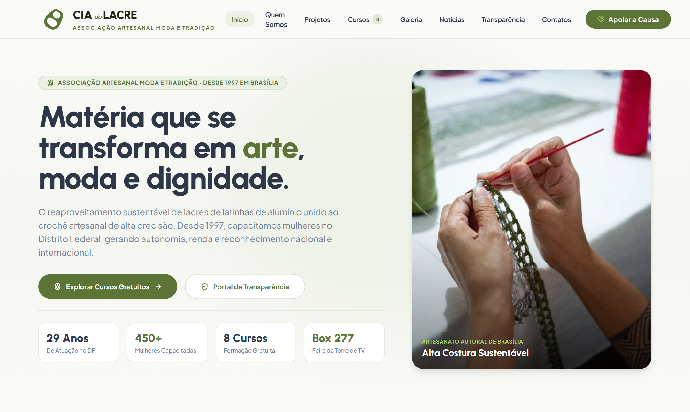 
      <strong>Home Editorial (Olive System)</strong> 
      <code>https://cia-do-lacre.vercel.app/</code>
    </td>
    <td align="center" width="50%">
      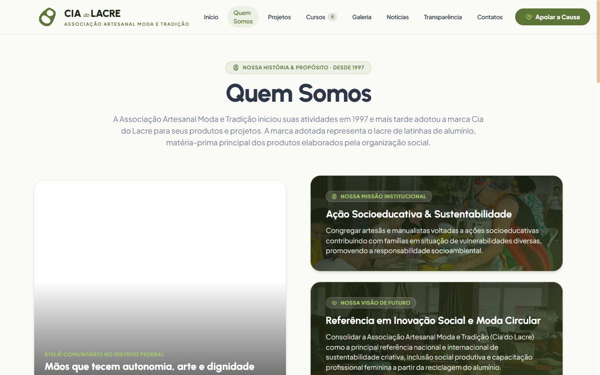 
      <strong>Quem Somos &amp; Governança</strong> 
      29 anos de impacto sociocultural no DF
    </td>
  </tr>
</table>

---

### 2. Portal da Transparência Ativa (MROSC) & Projetos Comunitários
Conformidade rigorosa com o **Ministério da Cultura** e **MPDFT**: busca por projeto/processo SEI, filtros por órgão parceiro, *accordions* organizados e **visualizador embutido de PDFs** sem abrir novas abas.

<table>
  <tr>
    <td align="center" width="50%">
      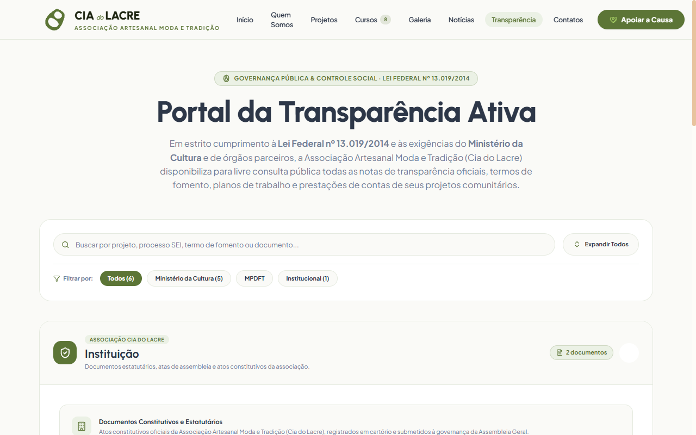 
      <strong>Portal da Transparência Ativa (Lei 13.019/2014)</strong> 
      Busca por SEI, filtros por órgão e 18 PDFs embutidos
    </td>
    <td align="center" width="50%">
      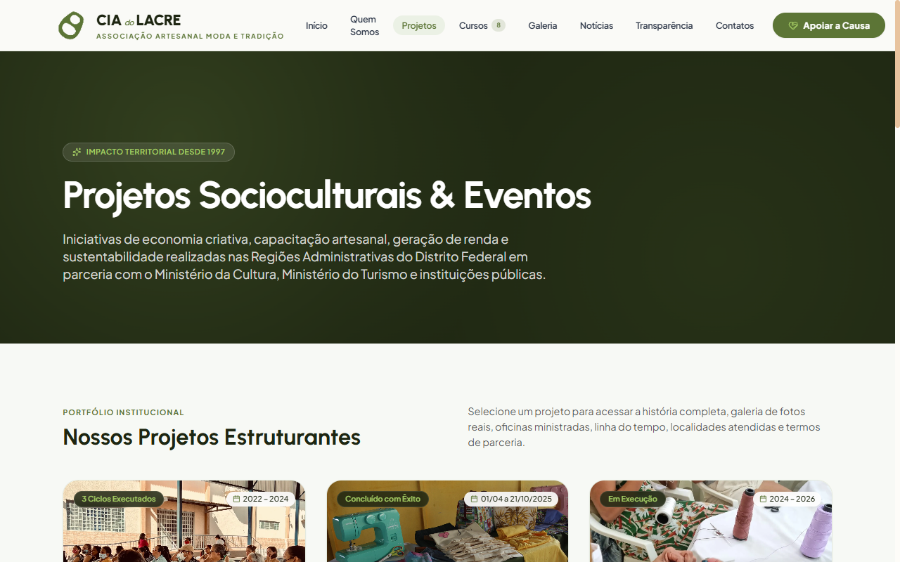 
      <strong>Projetos &amp; Eventos</strong> 
      Vitrine de iniciativas como <em>Mãos Sustentáveis</em>
    </td>
  </tr>
</table>

---

### 3. Oficinas Gratuitas, Galeria de Fotos & Voluntariado (Lei 9.608/1998)
Divulgação dos **8 cursos autorais**, galeria fotográfica filtrável por projeto (34 registros reais com lightbox) e página de apoio/PIX + **Termo de Voluntariado** em conformidade legal.

<table>
  <tr>
    <td align="center" width="33%">
      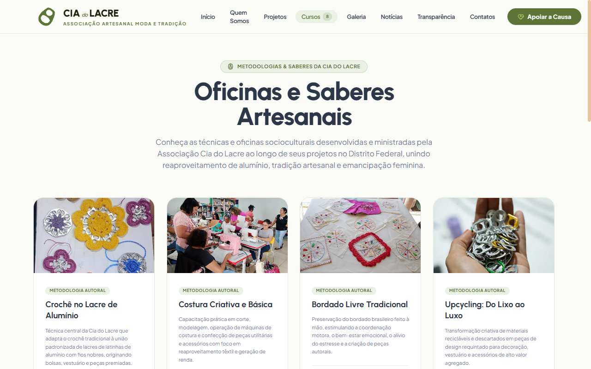 
      <strong>8 Cursos &amp; Oficinas</strong> 
      Crochê no lacre, costura e upcycling
    </td>
    <td align="center" width="33%">
      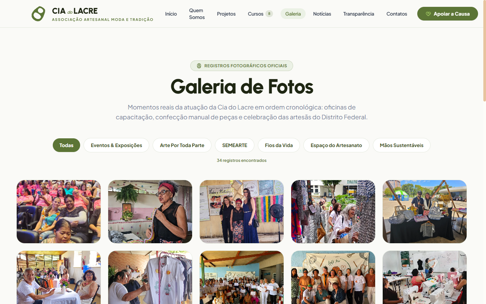 
      <strong>Galeria Fotográfica</strong> 
      Filtros por projeto e lightbox
    </td>
    <td align="center" width="33%">
      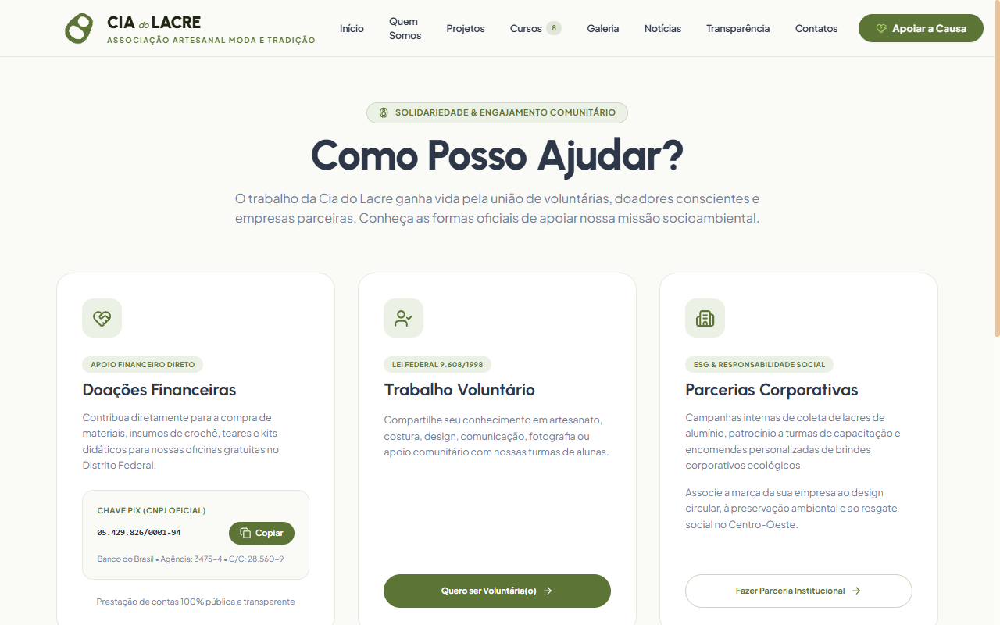 
      <strong>Apoiar &amp; Voluntariado</strong> 
      PIX oficial e Lei 9.608/1998
    </td>
  </tr>
</table>

---

### 📱 Experiência Mobile (Acessível no Celular)

<table>
  <tr>
    <td align="center" width="25%">
      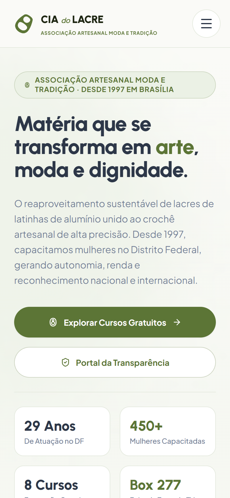 
      <strong>Home Mobile</strong>
    </td>
    <td align="center" width="25%">
      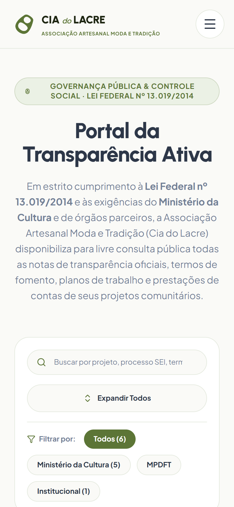 
      <strong>Transparência MROSC</strong>
    </td>
    <td align="center" width="25%">
      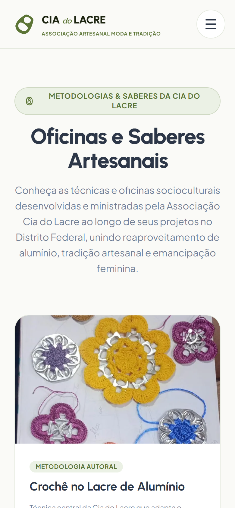 
      <strong>Cursos Mobile</strong>
    </td>
    <td align="center" width="25%">
      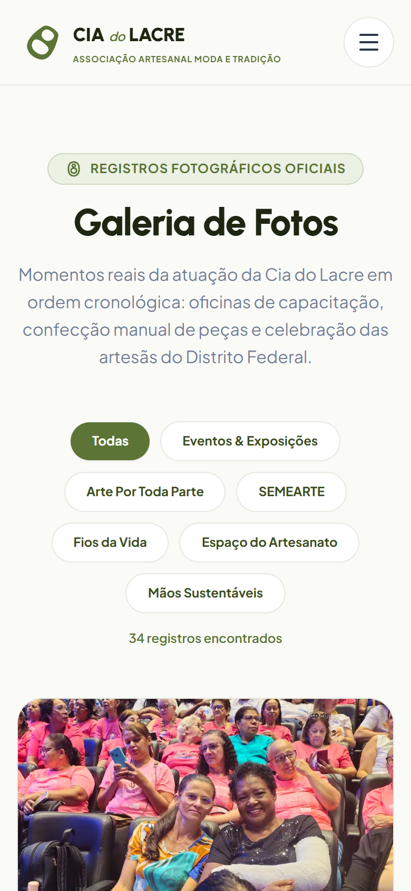 
      <strong>Galeria Mobile</strong>
    </td>
  </tr>
</table>

---

## 🧠 Arquitetura Custo Zero (Sem VPS)

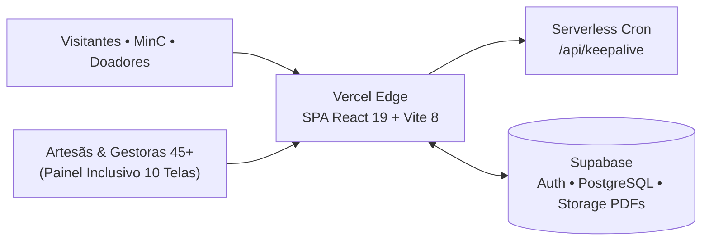

<strong>🛠️ Stack & Diretrizes de Design Inclusivo</strong>

- **Frontend:** React 19, Vite 8, Tailwind CSS, React Router v7, GSAP 3, Embla Carousel e visualizador modal embutido (`DocumentViewerModal`).
- **Painel Inclusivo (10 telas):** botões largos, linguagem direta sem jargão técnico, confirmação explícita antes de ações destrutivas e proteção contra remoção acidental da conta principal.
- **Hospedagem & Manutenção:** 100% serverless (Vercel + Supabase + `/api/keepalive`), eliminando custos fixos de VPS ou plataformas proprietárias.

---

  <a href="https://cia-do-lacre.vercel.app/"><strong>🌐 Acessar Cia do Lacre Oficial</strong></a> &nbsp;•&nbsp; <a href="../README.md"><strong>← Voltar ao Portfólio Principal</strong></a>

