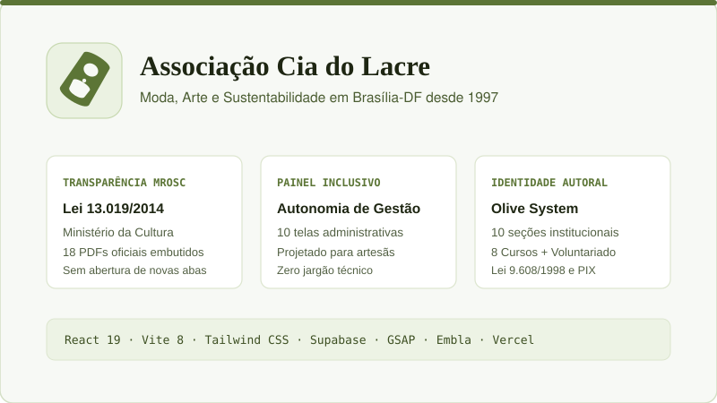

# Estudo de Caso — Associação Cia do Lacre (Portal Institucional, Transparência MROSC & Painel Inclusivo)

> **Status do repositório:** Privado (Projeto Institucional de Cliente / Terceiro Setor)  
> **Nota de confidencialidade:** este estudo de caso descreve o trabalho de desenvolvimento, design e manutenção sem expor código-fonte, credenciais, fluxos internos administrativos ou dados restritos da associação.

[← Voltar ao Portfólio Principal](../README.md)

---

## 1. Contexto

A **Associação Artesanal Moda e Tradição — Cia do Lacre**, fundada em 1997 em Brasília-DF, transforma lacres de alumínio em moda autoral, arte sustentável e geração de renda comunitária. O projeto envolveu a reconstrução completa de sua presença digital institucional e a criação de um ambiente administrativo pensado especificamente para autonomia de uso pelas próprias artesãs e gestoras comunitárias.

---

## 2. Problema Identificado

A associação precisava superar três desafios concretos:
1. **Dependência tecnológica legada:** desvincular o site de plataformas externas fechadas, reduzindo custos recorrentes e garantindo propriedade total sobre o código e o conteúdo.
2. **Conformidade legal rigorosa:** apresentar a prestação de contas e documentos de parcerias públicas conforme as exigências do **Ministério da Cultura** sob o **Marco Regulatório das Organizações da Sociedade Civil (MROSC — Lei 13.019/2014)**, de forma organizada, acessível e sem obrigar o cidadão a baixar arquivos cegamente ou abrir múltiplas abas.
3. **Barreira de usabilidade na manutenção diária:** painéis administrativos técnicos tradicionais são complexos para usuárias 45+ sem familiaridade técnica prévia, gerando dependência constante de suporte externo para publicar fotos, notícias, projetos ou novos relatórios.

---

## 3. Objetivo

Entregar uma aplicação web moderna, leve, fiel à identidade visual da associação e preparada para longo prazo:
- Refletir a sofisticação do artesanato sustentável com design editorial autoral (sem templates genéricos).
- Garantir transparência pública auditável e navegação simples no **Portal da Transparência MROSC**.
- Fornecer um **Painel Administrativo inclusivo** com linguagem clara, feedbacks explícitos e autonomia total para atualização de conteúdo.

---

## 4. Solução Desenvolvida

Foi desenvolvida uma aplicação SPA moderna em **React 19 + Vite 8 + Tailwind CSS**, hospedada na **Vercel** e integrada ao **Supabase** (autenticação, banco e mídia), acompanhada por função serverless de rotina (`/api/keepalive`) para preservar a disponibilidade contínua do ambiente:
- **Identidade Visual (*Olive System*):** paleta verde oliva oficial (`#5C7536`, `#3D4F22`, `#1E2612`, `#A3CC63`, `#F7F9F5`) combinada à tipografia editorial (`Fraunces` + `Plus Jakarta Sans`) e ao emblema íntegro do lacre.
- **Portal da Transparência MROSC:** organização por projetos em *accordions* claros com **visualizador embutido de documentos (`DocumentViewerModal`)** atendendo **18 PDFs oficiais** sem abrir novas abas.
- **Painel Administrativo Inclusivo (10 páginas):** interface ergonômica voltada à clareza, contraste e prevenção de erros para gestão independente de diretoria, fotos do site, galeria, notícias, projetos, documentos de transparência e usuários.

---

## 5. Principais Funcionalidades

### Área Pública (10 Seções Institucionais)
- **Home Editorial:** narrativa visual da associação, destaques e navegação fluida com animações leves (`GSAP` e `Embla Carousel`).
- **Quem Somos:** história desde 1997, liderança (Mestra Chica Rosa) e governança.
- **Projetos e Eventos:** vitrine de iniciativas (incluindo *Mãos Sustentáveis*) com páginas de detalhe dedicadas.
- **Cursos:** apresentação dos **8 cursos oficiais** com chamada direta para inscrição/contato via WhatsApp.
- **Portal da Transparência MROSC (Lei 13.019/2014 — Ministério da Cultura):** *accordions* por projeto/parceria e leitura embutida de 18 documentos oficiais em PDF.
- **Como Posso Ajudar:** informações de apoio, PIX institucional e **Termo de Voluntariado** em conformidade com a **Lei 9.608/1998**.
- **Galeria de Fotos (Lightbox), Vídeos (YouTube), Notícias com página de detalhe e Contatos.**

### Painel Administrativo Inclusivo (Área Restrita)
- 10 telas dedicadas: Login, Dashboard simplificado, Diretoria, Fotos do Site, Galeria, Notícias, Projetos, Transparência MROSC, Gestão de Usuários (com proteção contra remoção acidental da conta principal) e avisos contextuais.

---

## 6. Tecnologias Utilizadas

| Camada | Tecnologias Comprovadas |
| :--- | :--- |
| **Frontend & UI** | React 19, Vite 8, Tailwind CSS 3, React Router v7, Lucide React |
| **Animação & Mídia** | GSAP 3, Embla Carousel, visualizador modal embutido de PDFs |
| **Backend as a Service** | Supabase (`@supabase/supabase-js`) |
| **Qualidade & Hospedagem** | Oxlint, Vercel (rewrites SPA + Serverless Function `/api/keepalive` via cron) |

---

## 7. Arquitetura (Nível Conceitual Autorizado)

```text
[ Visitantes / Ministério da Cultura / Doadores ]    [ Artesãs / Gestoras (Admin) ]
                       │                                           │
                       ▼                                           ▼
┌─────────────────────────────────────────────────────────────────────────────────┐
│                     Vercel Edge + SPA React 19 / Vite 8                         │
│  • 10 Seções Institucionais (Olive System)       • Painel Inclusivo (10 telas)  │
│  • Transparência MROSC (18 PDFs embutidos)       • Serverless Cron /keepalive   │
└─────────────────────────────────────────────────────────────────────────────────┘
                                       │
                                       ▼
                     [ Supabase (Dados, Auth e Mídia) ]
```

---

## 8. Captura Real & Identidade Visual Entregue

### Portal Institucional em Produção (`https://cia-do-lacre.vercel.app/`)


### Síntese Visual & Estrutura Entregue
<picture>
  <source media="(prefers-color-scheme: dark)" srcset="../assets/cover-cia-dark.svg">
  <source media="(prefers-color-scheme: light)" srcset="../assets/cover-cia-light.svg">
  
</picture>

---

## 9. Resultados Comprováveis

- **Desvinculação completa** de plataforma legada, passando a operar sobre arquitetura limpa React/Vite + Supabase + Vercel sem necessidade de VPS dedicada.
- **Conformidade documental MROSC:** acervo de **18 PDFs oficiais** publicados sob estrutura de *accordions* com visualização embutida na própria página.
- **Autonomia operacional:** 10 telas administrativas dedicadas permitindo que a própria associação atualize notícias, galeria, diretoria, projetos e documentos de transparência com segurança e manutenção ativa.

---

## 10. Link para Demonstração

- **Site Público Oficial:** [https://cia-do-lacre.vercel.app/](https://cia-do-lacre.vercel.app/)

---

[← Voltar ao Portfólio Principal](../README.md)
