

# 🩺 FisioTeraHub — SaaS Multi-tenant para Clínicas de Fisioterapia

**Do agendamento ao prontuário imutável (COFFITO/LGPD), convênios ANS TISS 4.01 e 57.064 RPS em 1 vCPU.**

  
  
  
  
  

  
  
  
  

[← Voltar ao Portfólio Principal](../README.md) • [🌐 Acessar Plataforma](https://fisioterahub.com) • [📸 Tour pelos Módulos](#-tour-pelos-módulos-prints-reais) • [⚡ Benchmark 57k RPS](#-benchmark-real-de-carga-57064-rps-em-1-vcpu)

> **Nota de confidencialidade:** produto comercial de código privado. Todas as capturas abaixo foram registradas em ambiente demonstrativo com dados fictícios (`Clínica OrthoVita`), sem expor código proprietário ou dados reais de pacientes.

---

## 💡 O Desafio

Clínicas de fisioterapia e Pilates frequentemente operam no improviso: agenda no WhatsApp, prontuários em papel sem rastreabilidade (**COFFITO / LGPD**), faturamento manual de guias **ANS TISS / TUSS** e planilhas financeiras desconectadas. O **FisioTeraHub** unifica toda a clínica em um SaaS multi-tenant seguro, auditável e absurdamente rápido mesmo rodando em uma VPS enxuta de **1 vCPU / 2 GB RAM**.

---

## 📸 Tour pelos Módulos (Prints Reais)

### 1. Página Pública & Dashboard Executivo
Entrada comercial focada em conversão e painel gerencial com indicadores em tempo real, ações rápidas do dia, status dos módulos contratados e auditoria de acessos recentes.

<table>
  <tr>
    <td align="center" width="50%">
      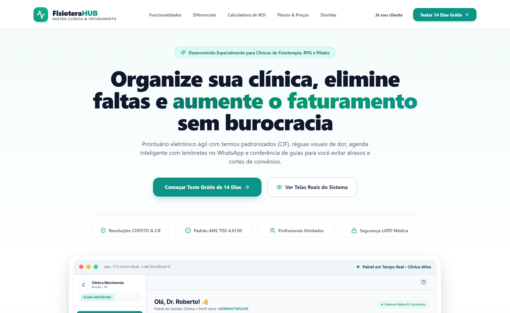 
      <strong>Landing Page Pública</strong> 
      <code>https://fisioterahub.com</code>
    </td>
    <td align="center" width="50%">
      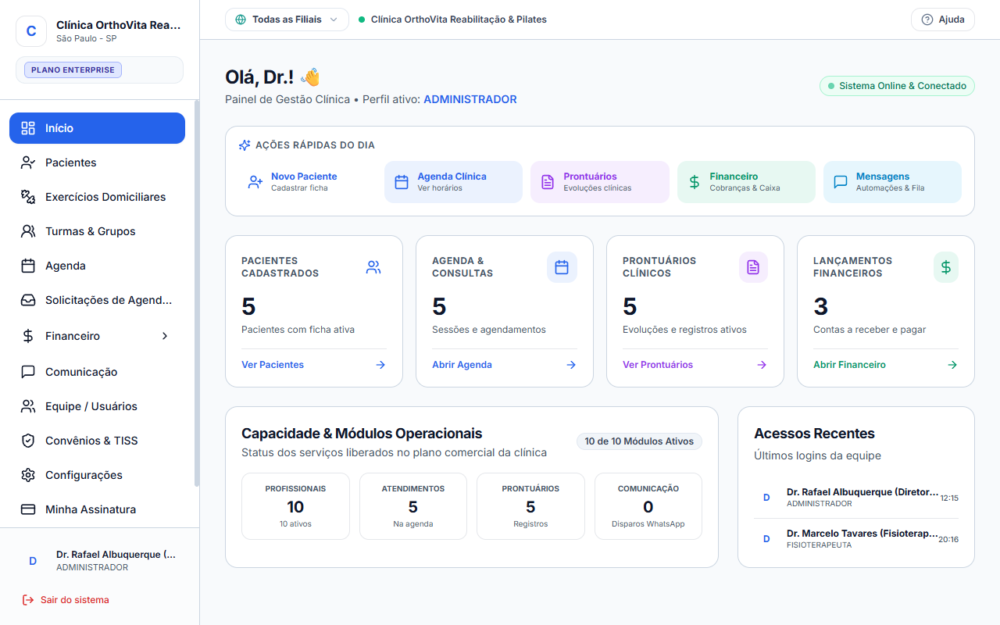 
      <strong>Painel de Gestão Clínica</strong> 
      KPIs do dia, ações rápidas e status multi-filial
    </td>
  </tr>
</table>

---

### 2. Agenda Clínica, Pacientes & Turmas de Pilates
Controle visual de horários por profissional e sala, gestão completa de prontuários longitudinais imutáveis e organização de turmas/grupos recorrentes.

<table>
  <tr>
    <td align="center" width="50%">
       
      <strong>Agenda Clínica Inteligente</strong> 
      Visão por status, profissional e sala
    </td>
    <td align="center" width="50%">
      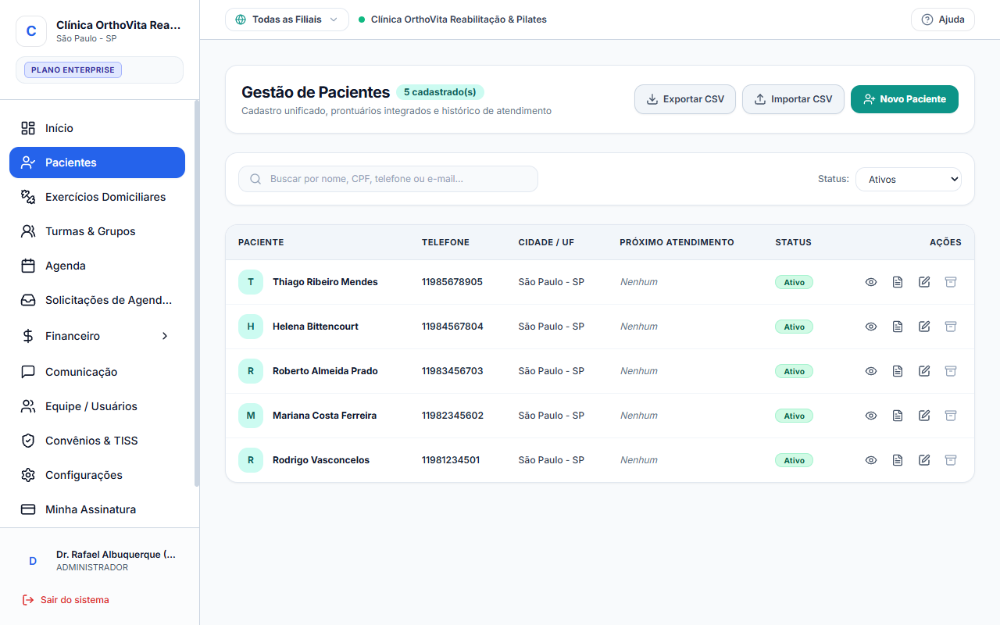 
      <strong>Gestão de Pacientes &amp; Prontuários</strong> 
      Evolução imutável alinhada ao COFFITO e LGPD
    </td>
  </tr>
  <tr>
    <td align="center" width="50%">
      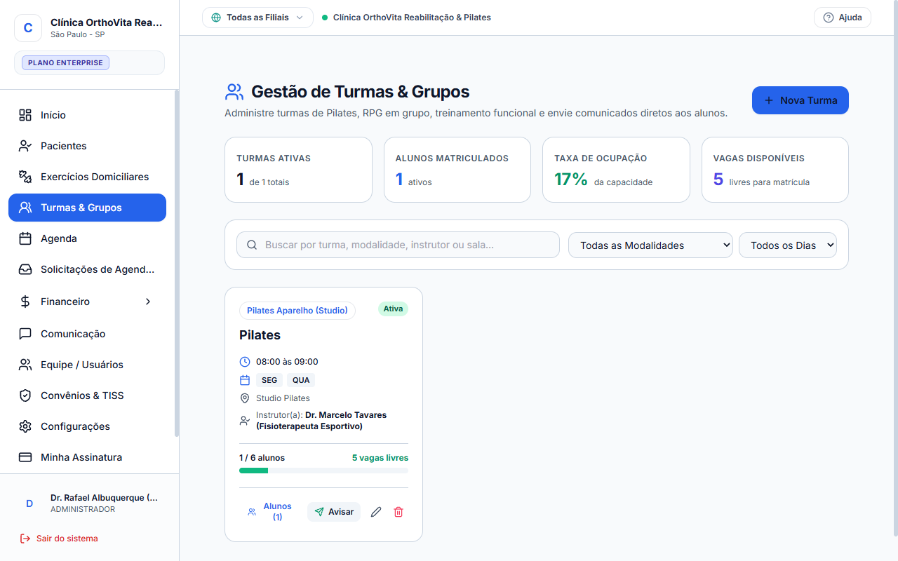 
      <strong>Turmas &amp; Grupos (Pilates / Reabilitação)</strong> 
      Controle de vagas, horários e frequência
    </td>
    <td align="center" width="50%">
      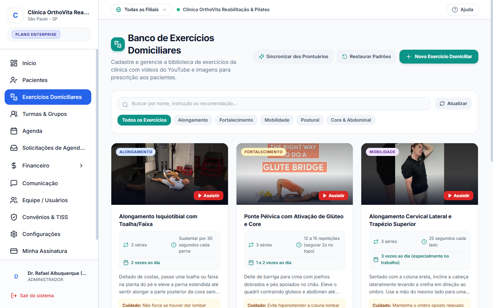 
      <strong>Banco de Exercícios Domiciliares</strong> 
      Biblioteca com vídeos do YouTube e prescrição ao paciente
    </td>
  </tr>
</table>

---

### 3. Financeiro, Convênios ANS TISS 4.01 & Comunicação WhatsApp
Faturamento completo com Pix/boletos (Asaas), importação OFX, tabela TUSS + geração de lotes XML TISS e régua automática de lembretes no WhatsApp (Evolution API) e e-mail (Resend).

<table>
  <tr>
    <td align="center" width="33%">
      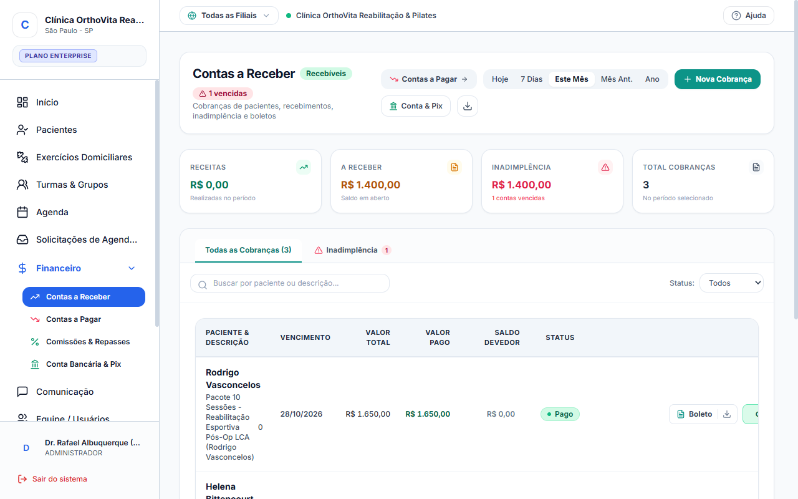 
      <strong>Financeiro &amp; Cobranças</strong> 
      Contas, Pix, boletos FEBRABAN e OFX
    </td>
    <td align="center" width="33%">
      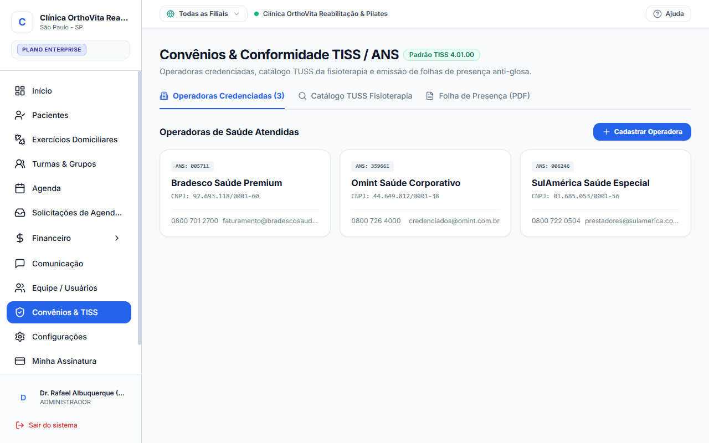 
      <strong>Convênios &amp; ANS TISS 4.01</strong> 
      Operadoras, códigos TUSS e lotes XML
    </td>
    <td align="center" width="33%">
      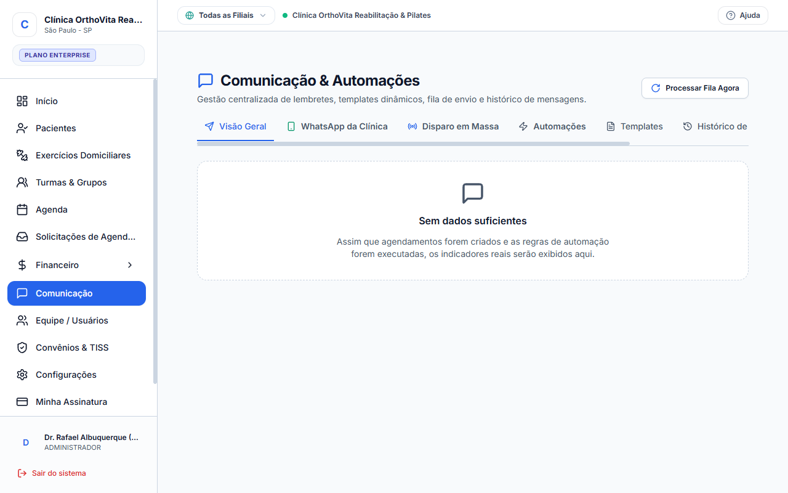 
      <strong>Comunicação &amp; WhatsApp</strong> 
      Lembretes automáticos anti-faltas
    </td>
  </tr>
</table>

---

### 📱 Experiência Mobile (Celular & Tablet)

<table>
  <tr>
    <td align="center" width="25%">
      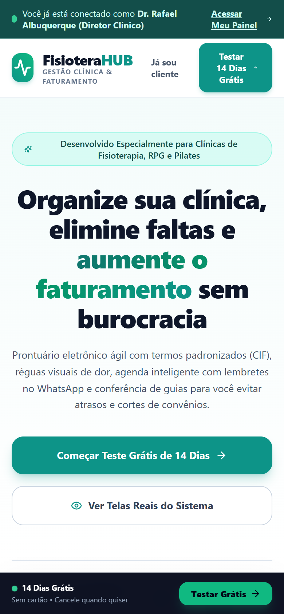 
      <strong>Landing Mobile</strong>
    </td>
    <td align="center" width="25%">
      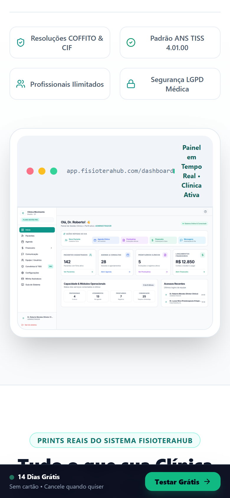 
      <strong>COFFITO &amp; TISS</strong>
    </td>
    <td align="center" width="25%">
      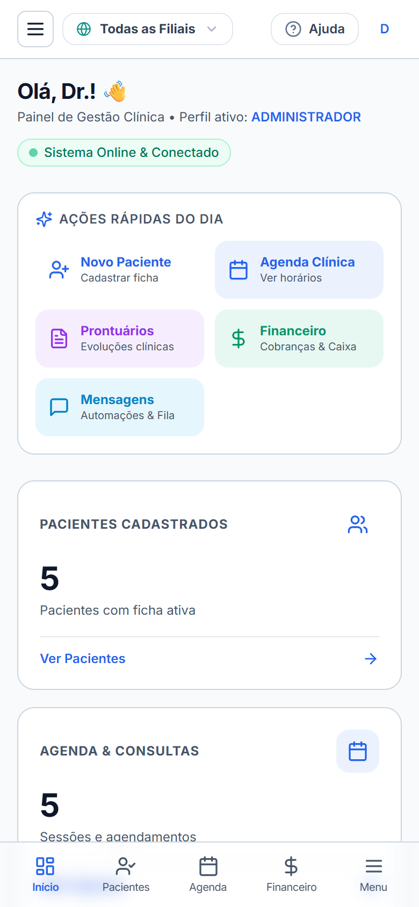 
      <strong>Dashboard Mobile</strong>
    </td>
    <td align="center" width="25%">
      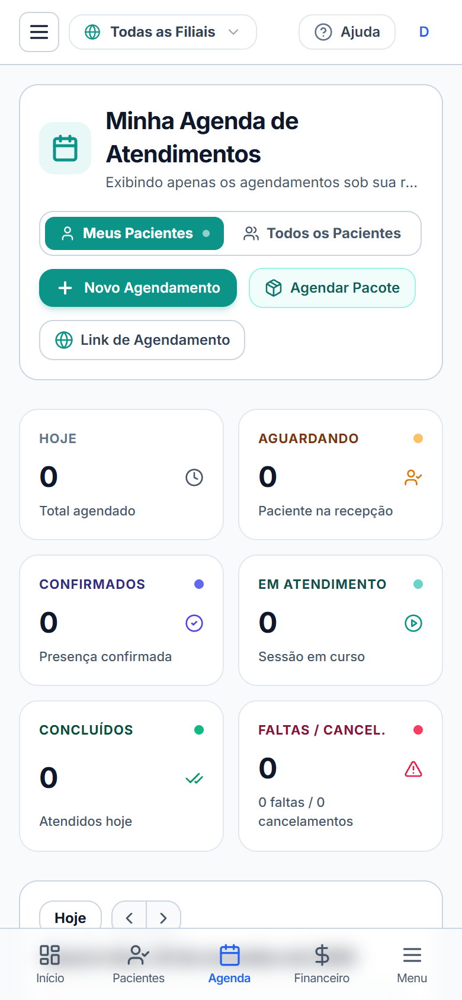 
      <strong>Agenda Mobile</strong>
    </td>
  </tr>
</table>

---

## 🧠 Arquitetura & Edge Microcaching

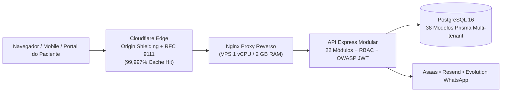

---

## ⚡ Benchmark Real de Carga (57.064 RPS em 1 vCPU)

Testes reais de estresse executados no **Loader.io** com **10.000 clientes simultâneos contínuos** sobre uma VPS de **1 vCPU / 2 GB RAM**:

| Métrica | Sem Edge Cache | Com Edge Microcaching (RFC 9111) | Ganho Real |
| :--- | :---: | :---: | :---: |
| **Vazão Média (RPS)** | ~2.508 RPS | **~57.064 RPS** | **+2.175%** |
| **Requisições em 1 min** | 150.527 | **3.423.876** | +3,27 milhões |
| **Latência Média** | 4.549 ms | **68 ms** *(mín. 5 ms)* | **-98,5%** |
| **Timeouts / Erros** | 14,4% (5.802) | **0,0% (Zero erros)** | 100% estável |
| **CPU da VPS sob Pico** | 100% saturada | **~10% (repouso)** | Origem protegida |

<strong>🛠️ Stack Completa & Salvaguardas de Engenharia</strong>

- **Backend:** Node.js 20, TypeScript 5.8, Express 4, Prisma ORM 6, Zod, JWT em memória + Refresh Token rotacionado em Cookie `HttpOnly, Secure, SameSite=Strict`, Helmet, Rate-Limit e PDFKit.
- **Frontend:** React 18, Vite 6, Tailwind CSS, TanStack Query v5, React Hook Form e React Router v7.
- **Banco & Performance:** PostgreSQL 16 com `tenantId` obrigatório, Nested Writes atômicos, eliminação de N+1 (`findMany` em lote), projeções `select` cirúrgicas e `Cache-Control: private, no-store` em todas as rotas LGPD.
- **Integrações:** Asaas (Pix, boletos e assinaturas), Resend (e-mail transacional) e Evolution API (WhatsApp).

---

  <a href="https://fisioterahub.com"><strong>🌐 Acessar FisioTeraHub em Produção</strong></a> &nbsp;•&nbsp; <a href="../README.md"><strong>← Voltar ao Portfólio Principal</strong></a>

