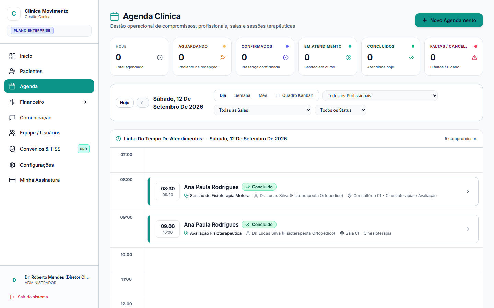

# Estudo de Caso — FisioTeraHub (Plataforma SaaS Multi-tenant para Clínicas de Fisioterapia)

> **Status do repositório:** Privado (Produto Comercial)  
> **Nota de confidencialidade:** este documento apresenta arquitetura autorizada, decisões técnicas e resultados reais de benchmark sem expor código-fonte proprietário, esquemas internos de banco, credenciais ou dados de clínicas/pacientes. Todas as capturas de tela exibem exclusivamente ambiente de homologação com dados fictícios de seed (`Clínica Movimento`).

[← Voltar ao Portfólio Principal](../README.md)

---

## 1. Contexto

O **FisioTeraHub** é uma plataforma SaaS B2B Multi-tenant voltada à gestão completa de clínicas de fisioterapia e reabilitação no Brasil. O sistema foi concebido para operar de ponta a ponta — da recepção e agendamento ao prontuário clínico imutável, faturamento de convênios médicos e gestão financeira — atendendo exigências regulatórias do setor de saúde brasileiro.

---

## 2. Problema Identificado

Clínicas de fisioterapia de pequeno e médio porte frequentemente enfrentam fragmentação operacional:
- Agendamentos controlados em planilhas ou aplicativos de mensagem sem controle de salas, profissionais ou fila de atendimento.
- Prontuários em papel ou editáveis sem rastreabilidade temporal, em desacordo com exigências do **COFFITO** e da **LGPD**.
- Alta complexidade manual no faturamento de convênios no padrão **ANS TISS / TUSS** e na conciliação financeira (Pix, boletos, repasses e inadimplência).
- Gargalo de infraestrutura em servidores enxutos durante picos de acesso simultâneo à agenda e portais públicos.

---

## 3. Objetivo

Desenvolver uma plataforma web única, segura, auditável e financeiramente sustentável em nuvem, capaz de:
1. Centralizar operação clínica, agenda, financeiro, convênios e portal do paciente com isolamento estrito por clínica (*multi-tenancy*).
2. Garantir conformidade regulatória brasileira (**ANS TISS 4.01**, **TUSS**, **COFFITO**, **LGPD** e **DMED**).
3. Suportar alta concorrência mesmo em hospedagem enxuta (1 vCPU / 2 GB RAM) por meio de engenharia de performance e cache inteligente.

---

## 4. Solução Desenvolvida

Foi construída uma arquitetura de **Monólito Modular** em workspaces TypeScript (`backend` + `frontend`), conteinerizada via Docker Compose com proxy reverso Nginx e camada de proteção/microcache em borda (Cloudflare):
- **22 módulos de domínio no backend** cobrindo autenticação, papéis/permissões, pacientes, triagem, prontuário clínico, agenda, turmas, sessões, financeiro, cobrança, convênios, tabela TUSS, comunicação, auditoria, assinaturas SaaS e painel SuperAdmin.
- **38 modelos relacionais via Prisma ORM** com escopo obrigatório de `tenantId` e trilha de auditoria LGPD.
- **Segurança de sessão no padrão OWASP** com Access Token em memória e Refresh Token rotacionado em Cookie `HttpOnly, Secure, SameSite=Strict`.

---

## 5. Principais Funcionalidades

- **Gestão de Pacientes & Portal do Paciente:** cadastro completo, importação/exportação validada, senha segura de portal e prescrição de exercícios domiciliares.
- **Prontuário Longitudinal Imutável:** evolução clínica com rastreabilidade, proteção contra alteração retroativa (alinhada ao COFFITO/LGPD) e exportação documental em PDF (`PDFKit`).
- **Agenda Clínica, Kanban & Turmas:** visualização por profissional/sala/status em tempo real, reagendamento controlado e gestão de turmas de atendimento.
- **Convênios ANS TISS 4.01 & Tabela TUSS:** cadastro de operadoras, códigos TUSS de fisioterapia e geração estruturada de guias/lotes XML TISS.
- **Financeiro & Cobrança:** contas a pagar/receber, boletos FEBRABAN/Pix, importação OFX, assinaturas integradas ao **Asaas** e relatórios gerenciais.
- **Comunicação & Notificações:** integração com e-mail transacional (**Resend**) e **WhatsApp** (Evolution API).
- **RBAC Granular & SuperAdmin SaaS:** matriz de permissões por perfil e gerenciamento centralizado de planos e tenants.

---

## 6. Tecnologias Utilizadas

| Camada | Tecnologias Comprovadas |
| :--- | :--- |
| **Backend** | Node.js 20, TypeScript 5.8, Express 4, Prisma ORM 6, Zod, Bcrypt, JWT + Refresh Token (`HttpOnly`), Helmet, Rate-Limit, PDFKit |
| **Frontend** | React 18, TypeScript, Vite 6, Tailwind CSS, TanStack Query v5, React Hook Form, React Router v7, Lucide Icons |
| **Banco de Dados** | PostgreSQL 16 (produção) e SQLite (desenvolvimento local zero-config) |
| **Integrações** | Asaas (pagamentos/assinaturas), Resend (e-mail), Evolution API (WhatsApp) |
| **Infraestrutura & QA** | Docker, Docker Compose, Nginx, Coolify, Cloudflare (Origin Shielding / RFC 9111), Playwright, Locust, Loader.io |

---

## 7. Arquitetura (Nível Conceitual Autorizado)

```text
[ Cliente Web / Portal do Paciente ]
                │
                ▼
┌───────────────────────────────────────────────┐
│ Cloudflare Edge (Origin Shielding · RFC 9111) │
│ • Rotas públicas/agenda: s-maxage=5 + SWR     │
│ • Assets Vite: max-age=1 ano, immutable       │
│ • Rotas LGPD/clínicas: private, no-store      │
└───────────────────────────────────────────────┘
                │
                ▼
┌───────────────────────────────────────────────┐
│ VPS 1 vCPU / 2 GB RAM (Docker Compose)        │
│ • Nginx (Proxy Reverso · gzip off p/ offload) │
│ • API Express Modular (22 módulos + RBAC)     │
│ • Prisma ORM (Nested Writes + Batch Queries)  │
│ • PostgreSQL 16 (Isolamento Multi-tenant)     │
└───────────────────────────────────────────────┘
```

Para rotas de escrita (onde não há cache), foram aplicadas quatro salvaguardas arquiteturais: **Nested Writes atômicos** no ORM, **eliminação de consultas N+1** via resolução em lote (`findMany` com `in` e `createMany`), **projeções cirúrgicas (`select`)** evitando `SELECT *` e cabeçalhos estritos `Cache-Control: private, no-store, no-cache, must-revalidate` em todos os dados protegidos por LGPD.

---

## 8. Capturas de Tela (Página Pública e Homologação — Dados Fictícios)

### Página Inicial Pública (`https://fisioterahub.com`)


### Dashboard Executivo e Visão Operacional


### Agenda Clínica e Acompanhamento de Atendimentos


---

## 9. Resultados Comprováveis (Benchmark de Carga Real)

Em ciclo de testes de estresse conduzido no **Loader.io** com **10.000 clientes simultâneos contínuos** sobre a infraestrutura de **1 vCPU / 2 GB RAM** (documentado no estudo técnico interno de setembro/2026):

| Métrica de Carga | Baseline (Sem Edge Cache) | Com Edge Microcaching (RFC 9111) | Impacto Comprovado |
| :--- | :---: | :---: | :---: |
| **Vazão Média (RPS)** | ~2.508 RPS *(saturação em ~1.350 clientes)* | **~57.064 RPS** | **+2.175% de capacidade** |
| **Requisições em 1 minuto** | 150.527 | **3.423.876** | +3,27 milhões de reqs |
| **Latência Média** | 4.549 ms | **68 ms** *(mínima de 5 ms)* | **-98,5% de latência** |
| **Taxa de Timeouts / Erros** | 14,4% (5.802 timeouts) | **0,0% (Zero erros)** | 100% de estabilidade |
| **Cache Hit Ratio na Borda** | — | **99,997%** | 12,06 GB offloaded |
| **CPU da VPS sob Pico** | 100% saturada | **~10% (repouso)** | Origem protegida |

Além do benchmark de carga, a suíte automatizada cobre testes críticos de segurança, TOTP, importação OFX, importação/exportação de pacientes, senha de portal e reagendamento clínico.

---

## 10. Link para Demonstração

- **Plataforma em Produção:** [https://fisioterahub.com](https://fisioterahub.com)

---

[← Voltar ao Portfólio Principal](../README.md)
