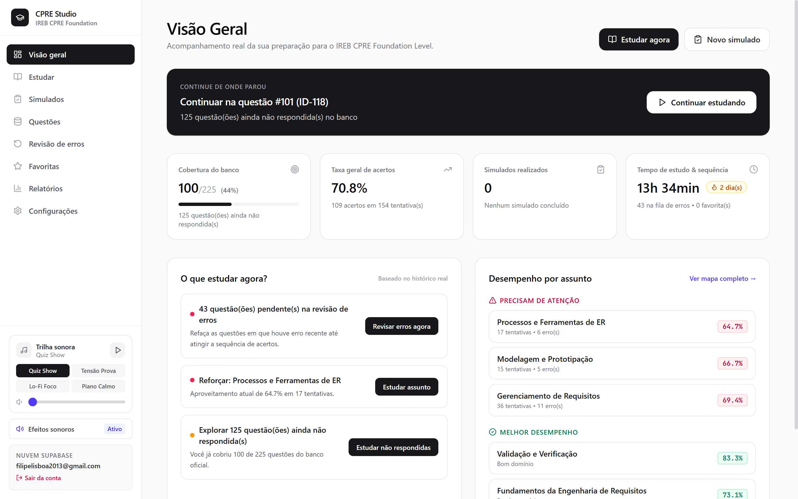
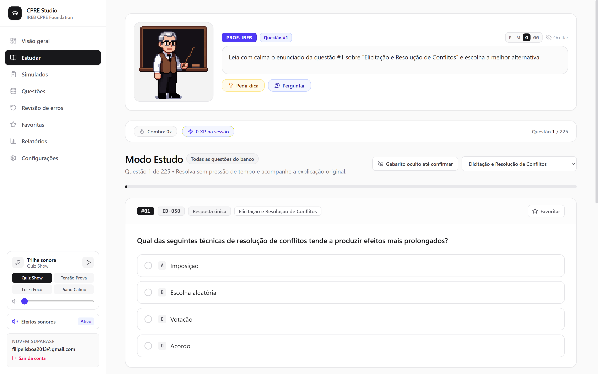
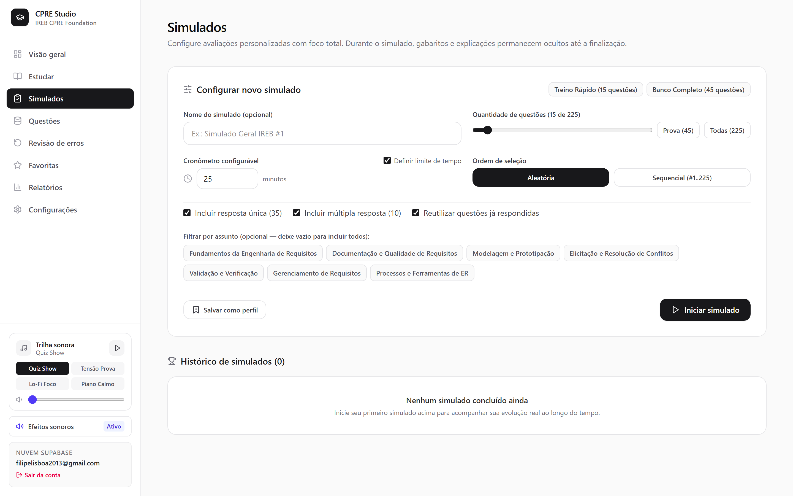
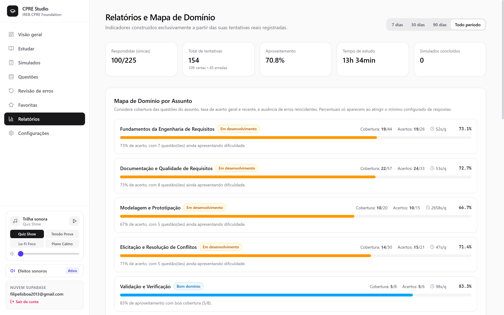

# Case 04 — CPRE Studio (Plataforma IREB CPRE-FL com IA, RAG & RPG Educacional)

**Domínio:** EdTech / Certificação em Engenharia de Requisitos (IREB CPRE Foundation Level)  
**Repositório:** Público ([`FlipLM/ireb-cpre-studio`](https://github.com/FlipLM/ireb-cpre-studio))  
**Demonstração:** https://ireb-cpre-studio.vercel.app  
**Stack:** `Next.js 15` · `React 19` · `TypeScript` · `Tailwind CSS 4` · `Supabase (PostgreSQL + Auth + RLS + FTS)` · `Vercel` · `PWA` · `Web Audio API` · `Vitest`

[← Voltar ao Portfólio Principal](../README.md)

---

## 1. O Problema

A preparação para a certificação **IREB CPRE Foundation Level** exige domínio preciso de terminologia oficial (Syllabus v3.x), prática constante com questões de resposta única e múltipla, revisão espaçada de erros recorrentes e explicações conceituais sem receber "spoilers" imediatos do gabarito. Além disso, o estudo precisa acontecer tanto no desktop quanto no celular (PWA instalável), com sensação instantânea de resposta e engajamento diário — sem custo de infraestrutura paga.

---

## 2. A Solução

O **CPRE Studio** foi construído como uma plataforma Full Stack completa de estudos, simulados, tutoria assistida por IA e gamificação em RPG:

- **Home Visão Geral (`/`) com Abertura Instantânea (*Stale-While-Revalidate*):**
  - Renderiza a interface e os últimos indicadores em **0ms** via cache em memória + `localStorage`, revalidando silenciosamente no Supabase em segundo plano.
  - Otimização de backend em `cloudGetDashboardAnalytics`: redução de **16 queries redundantes para 6 queries paralelas enxutas** em um único `Promise.all`.
- **Banco de 225 Questões IREB CPRE-FL:** 169 questões de resposta única e 56 de múltipla resposta (exigindo correspondência exata do conjunto), incluindo 11 questões com diagramas/figuras, explicações detalhadas e taxonomia nas 7 áreas temáticas da certificação.
- **Modo Estudo, Simulados Cronometrados & Revisão Espaçada (SM-2):** simulação real com gabarito bloqueado durante a prova, fila de revisão de erros por streak de acertos, favoritos, anotações pessoais, dashboard analítico e gráficos de evolução por tópico.
- **Módulo RPG — Jornada do Herói (`/rpg`):**
  - **4 Regiões temáticas** (*Gruta Esquecida*, *Caverna Assombrada*, *Caverna de Fogo* e *Dungeon de Gelo*) com grafos DAG determinísticos de **10 níveis** (40 níveis totais), bifurcações, eventos *Visual Novel*, Checkpoints, baús de recompensa e **Chefes Discursivos** no nível 10 avaliados por IA + RAG do Syllabus oficial.
  - **Arquitetura *Local-First* (`< 10ms`) com Fila Ordenada (`syncQueueRef`):** abertura de mapa e turnos de combate respondem instantaneamente no cliente enquanto sincronizam em sequência no Supabase (7 tabelas dedicadas com RLS `auth.uid() = user_id`).
  - **Regras Táticas de Combate:** `HERO TURN` com `MISS` sem perda de vida ao errar; `ENEMY TURN` com cronômetro de defesa com piso mínimo de **60 segundos (1 minuto)**; **dano proporcional em questões de múltipla escolha** (`1/2`, `1/3`, `2/3`) com trava anti-marcação excedente; e **baralho aleatório sem repetição** nas 225 questões durante toda a run.
  - **4 Classes de Heróis** (*Aldric*, *Lyra*, *Kael* e *Seraphina*), inventário de consumíveis/equipamentos (incluindo itens de eliminação de alternativas erradas) e **trilha sonora chiptune** sintetizada em tempo real via Web Audio API.
- **Prof. IREB — Tutor Interativo em Pixel Art (Visual Novel):**
  - Sprites autorais com 5 animações (`idle`, `talking`, `thinking`, `angry_slam`, `celebrate_clap`), tamanho configurável (`P / M / G / GG`) no desktop e **popup flutuante transparente, arrastável e redimensionável** com menu lateral de chat no mobile.
  - **Skill Pedagógica Parametrizável (`prompts/professor-ireb.skill.md`):** separa **Pedir Dica** (pontos-chave progressivos sem entregar a resposta) e **Perguntar** (Modo Aula Liberal).
- **Base de Conhecimento Oficial (RAG) no Supabase:** tabela `ireb_knowledge_base` com **Full-Text Search em Português (`tsvector` + índice `GIN`)** contendo as **7 Unidades Educacionais (EU 1 a EU 7)** do Syllabus oficial IREB CPRE-FL.
- **Cascata Multi-IA 100% Gratuita com Fallback Automático:** orquestração server-side em cascata (`Groq` → `Cerebras` → `OpenRouter :free` com trava anti-modelos-pagos → `Gemini`), com fallback heurístico local.
- **Autenticação, Isolamento RLS, Keep-Alive e PWA:** Supabase Auth + **Row Level Security** em 17 tabelas (10 de estudos + 7 do RPG), cron na Vercel (`0 9 */3 * *` em `/api/keepalive`) e Service Worker (`sw.js`) + Web App Manifest iniciando na Visão Geral (`/`).

---

## 3. Capturas de Tela (Ambiente em Produção)

### 💻 Desktop — Visão Geral, Estudo, Simulados & Relatórios

<table>
  <tr>
    <td align="center" width="50%">
       
      <strong>Visão Geral (Home SWR 0ms)</strong>
    </td>
    <td align="center" width="50%">
       
      <strong>Modo Estudo + Prof. IREB (Pixel Art + RAG)</strong>
    </td>
  </tr>
  <tr>
    <td align="center" width="50%">
       
      <strong>Simulados Cronometrados</strong>
    </td>
    <td align="center" width="50%">
       
      <strong>Relatórios e Mapa de Domínio</strong>
    </td>
  </tr>
</table>

### ⚔️ Desktop — Módulo RPG (Jornada do Herói ao vivo)

<table>
  <tr>
    <td align="center" width="50%">
       
      <strong>Mapa DAG de Nós (Gruta Esquecida — 10 níveis)</strong>
    </td>
    <td align="center" width="50%">
       
      <strong>Arena de Combate Tático Local-First</strong>
    </td>
  </tr>
</table>

### 📱 Versão Mobile (PWA Instalável)

<table>
  <tr>
    <td align="center" width="25%">
       
      <strong>Visão Geral</strong>
    </td>
    <td align="center" width="25%">
       
      <strong>Estudo + Prof. IREB</strong>
    </td>
    <td align="center" width="25%">
       
      <strong>Mapa RPG</strong>
    </td>
    <td align="center" width="25%">
       
      <strong>Combate RPG</strong>
    </td>
  </tr>
</table>

---

## 4. Evidências de Engenharia

- **Integridade & Regras Testadas com Vitest (19/19 testes passando):**
  - `bank-and-integrity.test.ts` (6 testes): valida as 225 questões, gabaritos únicos e múltiplos, ausência de duplicidades, resolução de imagens e bloqueio de gabarito durante simulados.
  - `rpg-jornada-do-heroi.test.ts` (13 testes): valida feature flag, DAGs determinísticos sem ciclos/órfãos, regras de checkpoint e limite de 3 heróis, itens de eliminação, cálculo de dano/crítico/parry, piso mínimo de 60s no `ENEMY TURN`, ciclo completo de 225 questões sem repetição na run e frações de dano em múltipla escolha (`1/2`, `1/3`, `2/3`).
- **Performance & Arquitetura Custo Zero:** *Local-First* no RPG (`< 10ms`), *Stale-While-Revalidate* na Home (`0ms`), deduplicação de 16 → 6 queries no Supabase, hospedagem serverless na Vercel + Keep-Alive automático + fallback multi-provedor de IA.

---

[← Voltar ao Portfólio Principal](../README.md)
