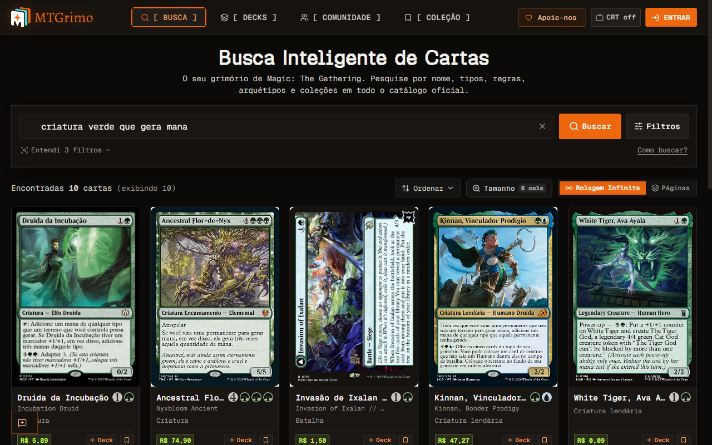
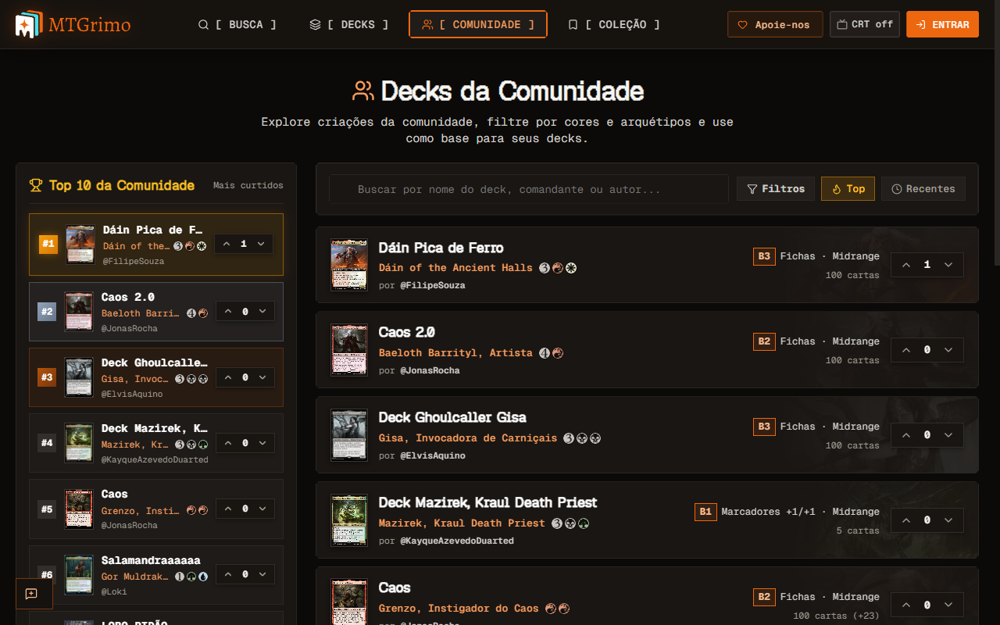
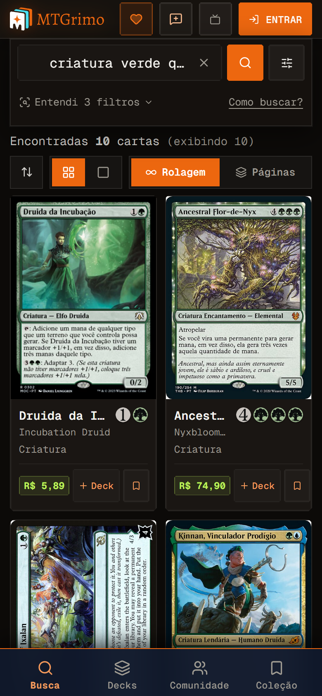
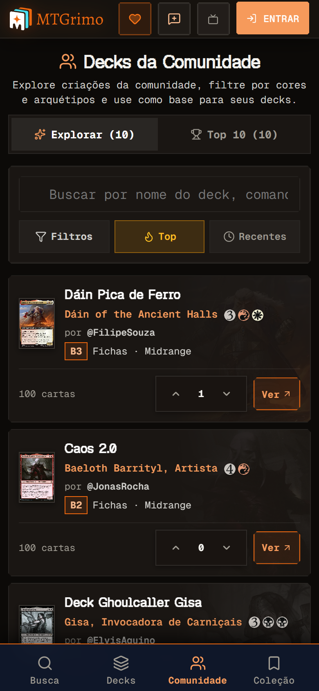
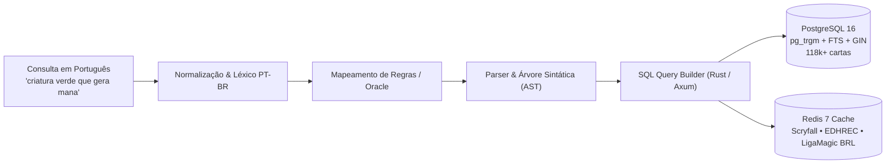

# 🧙‍♂️ MTGrimo — Motor Autoral de Busca de Cartas & NLP Determinístico PT-BR

**Pesquise em 118.000+ cartas de Magic: The Gathering falando português natural — sem alucinação de LLM, sem custo por token e com cotações em reais.**

  
  
  
  
  

  
  
  
  

[← Voltar ao Portfólio Principal](../README.md) • [🌐 Acessar MTGrimo](https://mtgrimo.com/) • [📸 Prints em Produção](#-prints-reais-em-produção) • [🧠 Pipeline NLP](#-pipeline-do-motor-de-busca-determinístico)

> **Nota de autoria e confidencialidade:** o **MTGrimo** é um projeto colaborativo de código privado. Este estudo de caso documenta minha atuação específica no **mecanismo autoral de busca de cartas, integrações com APIs de bases de dados e conversor determinístico de linguagem natural PT-BR → AST → SQL**.

---

## 💡 O Desafio

Jogadores brasileiros de *Magic: The Gathering* (especialmente *Commander*) esbarravam em duas barreiras: memorizar sintaxes obscuras em inglês (`t:creature id<=bg o:"add"`) ou depender de LLMs caros, lentos e sujeitos a alucinações. A solução foi criar um **parser semântico PT-BR 100% determinístico** em Rust, conectado ao PostgreSQL (`pg_trgm` + `GIN`), Redis e APIs externas (**Scryfall**, **EDHREC** e **LigaMagic BRL**).

---

## 📸 Prints Reais em Produção

### 💻 Versão Desktop (`https://mtgrimo.com/`)

<table>
  <tr>
    <td align="center" width="50%">
       
      <strong>Grimório &amp; Catálogo Principal</strong> 
      Busca instantânea em português sobre 118k+ cartas
    </td>
    <td align="center" width="50%">
       
      <strong>NLP PT-BR em Ação</strong> 
      <em>"criatura verde que gera mana"</em> &rarr; <strong>Entendi 3 filtros</strong> + preços em BRL
    </td>
  </tr>
</table>

### Decks da Comunidade (Top 10, Brackets & Arquétipos)

---

### 📱 Versão Mobile (Responsivo)

<table>
  <tr>
    <td align="center" width="50%">
       
      <strong>Busca Semântica Mobile</strong> 
      Filtros em português, cotações em R$ e rolagem infinita
    </td>
    <td align="center" width="50%">
       
      <strong>Decks da Comunidade Mobile</strong> 
      Ranking, votação e navegação por abas
    </td>
  </tr>
</table>

---

## 🧠 Pipeline do Motor de Busca Determinístico

<strong>🛠️ Stack & Resultados Comprováveis</strong>

- **Motor & Backend:** Rust (Axum, Tokio), parser estruturado PT-BR → AST → SQL determinístico (zero custo por token e resultados 100% reproduzíveis).
- **Dados & APIs:** PostgreSQL 16 (`pg_trgm` + índices GIN), Redis 7, Scryfall (118k+ cartas / 123k+ faces), EDHREC (sinergias Commander) e LigaMagic (cotações BRL).
- **Clientes:** Web PWA em React 19 + Vite 8 e Mobile em React Native + Expo SDK 57 com persistência offline SQLite.

---

  <a href="https://mtgrimo.com/"><strong>🌐 Acessar MTGrimo em Produção</strong></a> &nbsp;•&nbsp; <a href="../README.md"><strong>← Voltar ao Portfólio Principal</strong></a>

