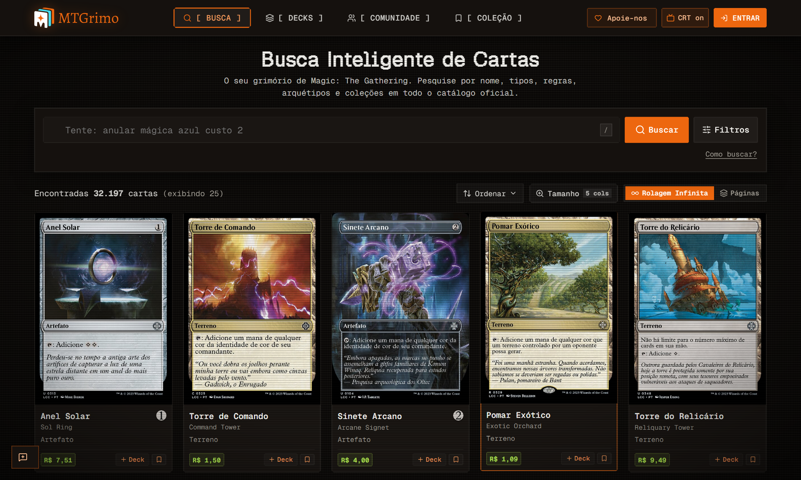
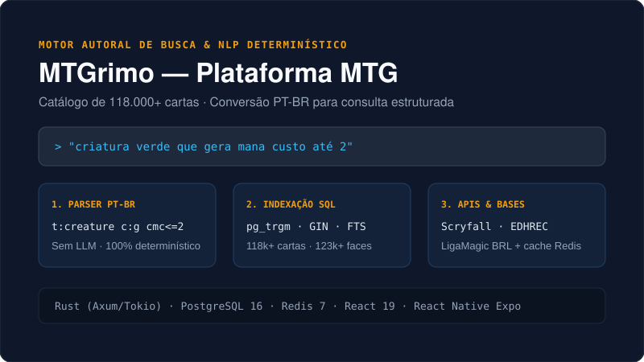

# Estudo de Caso — MTGrimo (Mecanismo Autoral de Busca de Cartas & NLP Determinístico)

> **Status do repositório:** Privado (Projeto Colaborativo Autorizado para Estudo de Caso)  
> **Nota de autoria e confidencialidade:** o projeto **MTGrimo** (`mtg-platform`) é uma plataforma completa desenvolvida em colaboração. Este estudo de caso destaca com transparência o meu papel específico no **desenvolvimento do mecanismo autoral de busca por cartas, integrações com APIs de bases de dados e conversão de linguagem natural (PT-BR) para o contexto do motor de busca**, sem expor código-fonte privado ou infraestrutura do projeto.

[← Voltar ao Portfólio Principal](../README.md)

---

## 1. Contexto

O **MTGrimo** é um ecossistema multiplataforma (Web PWA + Mobile com persistência offline) voltado a jogadores de **Magic: The Gathering** (com foco especial no formato *Commander*), reunindo catálogo completo de **118.000+ cartas e 123.000+ faces**, análise de sinergias de metagame e cotações multimoeda em tempo real.

---

## 2. Problema Identificado

Buscar cartas em um universo com mais de cem mil registros e milhares de interações de regras impõe duas barreiras sérias à experiência do usuário brasileiro:
1. **Sintaxe técnica árida:** motores tradicionais exigem memorização de operadores específicos em inglês (ex.: `t:creature id<=bg o:"add"`), afastando jogadores que pensam em termos naturais em português.
2. **Custo e imprevisibilidade de IA generativa:** delegar cada pesquisa de catálogo a um LLM externo introduz latência alta, custo variável por consulta e risco de traduções inconsistentes ou alucinadas.
3. **Fontes de dados heterogêneas:** informações de texto/faces, metagame/sinergias e preços em reais/dólares vivem em bases externas distintas que precisam conversar com rapidez e consistência.

---

## 3. Objetivo

Projetar e estruturar um **mecanismo autoral de busca de cartas** capaz de:
- Conectar-se e sincronizar dados de bases de referência de Magic: The Gathering via APIs.
- Converter consultas escritas em **linguagem natural em português (PT-BR)** para o contexto estruturado do motor de busca de forma **100% determinística** (sem caixa-preta de IA generativa).
- Entregar resultados rápidos, paginados e agrupados por edição sobre o catálogo completo de 118k+ cartas.

---

## 4. Solução Desenvolvida (Foco na Minha Contribuição)

Minha atuação concentrou-se no núcleo de busca e interpretação semântica que conecta a intenção do jogador à consulta estruturada no banco e às integrações de dados:
- **Conexão com APIs de Bases de Dados:** integração de carga e enriquecimento do catálogo oficial (**Scryfall**, com 118.000+ cartas e 123.000+ faces), sinergias/metagame (**EDHREC**) e cotações multimoeda (**LigaMagic em BRL** e **Scryfall em USD**) com camada de cache em Redis.
- **Conversão Determinística de Linguagem Natural (PT-BR):** pipeline composto por **léxico de domínio**, mapeamento de **palavras-chave e mecânicas** (tradução PT-BR → termos oficiais de regras/Oracle), parser para **Árvore Sintática Abstrata (AST)** e **construtor de consultas (`query_builder`)**.
- **Indexação de Alta Performance:** consultas executadas sobre **PostgreSQL 16** com extensão `pg_trgm`, *Full-Text Search* e índices **GIN**, garantindo buscas tolerantes a variação de grafia e baixa latência mesmo em filtros combinados.

---

## 5. Principais Funcionalidades do Ecossistema

- **Busca em Linguagem Natural PT-BR & Sintaxe Estruturada:** aceita desde frases naturais em português até operadores estruturados combinados (tipo, cor/identidade WUBRG, custo de mana, texto de regras, raridade e legalidade).
- **Paginação e Agrupamento por Edições:** consolidação de múltiplas reimpressões sem poluir os resultados.
- **Integração de Dados e Cotações:** sincronização de cartas/faces (Scryfall), histórico de preços multimoeda (BRL/USD) e recomendações de sinergia (EDHREC).
- **Deck Builder & Análise de Commander:** validação de identidade de cor WUBRG e análise funcional por pilares do formato.
- **Experiência Multiplataforma:** Frontend Web em **React 19 + Vite 8** e aplicativo Mobile em **React Native + Expo SDK 57** com persistência relacional offline via SQLite.

---

## 6. Tecnologias Utilizadas

| Camada | Tecnologias Comprovadas |
| :--- | :--- |
| **Backend & Motor de Busca** | Rust (Axum, Tokio), Parser estruturado / AST / Lexicon / Conversor NLP PT-BR determinístico |
| **Banco de Dados & Cache** | PostgreSQL 16 (`pg_trgm`, Full-Text Search, índices GIN), Redis 7 Alpine |
| **APIs & Fontes de Dados** | Scryfall (118k+ cartas / 123k+ faces), EDHREC (sinergias/metagame), LigaMagic (cotações BRL) |
| **Clientes Web & Mobile** | React 19 + Vite 8 (Web), React Native + Expo SDK 57 + SQLite offline (Mobile) |
| **Infraestrutura** | Docker Multi-Stage, Docker Compose, Nginx e Coolify |

---

## 7. Arquitetura do Mecanismo de Busca (Conceitual Autorizado)

```text
  Consulta em Português (ex.: "criatura verde que gera mana custo até 2")
                                    │
                                    ▼
┌────────────────────────────────────────────────────────────────────────┐
│            Mecanismo Autoral de Busca (100% Determinístico)            │
│  [ Normalização & Léxico PT-BR ] → [ Mapeamento Keywords / Regras ]    │
│                 → [ Parser & AST ] → [ SQL Query Builder ]             │
└────────────────────────────────────────────────────────────────────────┘
                                    │
                 ┌──────────────────┴──────────────────┐
                 ▼                                     ▼
   [ PostgreSQL 16 (pg_trgm + GIN) ]        [ Cache Redis 7 + APIs ]
     118k+ cartas · 123k+ faces             Scryfall · EDHREC · LigaMagic
```

---

## 8. Captura Real & Representação do Motor de Busca

### Busca Inteligente em Produção (`https://mtgrimo.com/`)


### Diagrama Conceitual do Mecanismo de Busca


---

## 9. Resultados Comprováveis

- **Catálogo completo indexado:** busca estruturada e em linguagem natural operando sobre **118.000+ cartas e 123.000+ faces** sincronizadas do Scryfall.
- **Previsibilidade sem custo por token:** a conversão determinística PT-BR → AST → SQL elimina latência de LLMs externos e garante respostas reproduzíveis para a mesma entrada.
- **Cobertura arquitetural consolidada:** as 13 fases estruturais da plataforma (incluindo busca avançada, cotações multimoeda, sinergias EDHREC e parser semântico PT-BR) constam concluídas e cobertas por testes unitários e de integração.

---

## 10. Link para Demonstração

- **Plataforma Web em Produção:** [https://mtgrimo.com/](https://mtgrimo.com/)

---

[← Voltar ao Portfólio Principal](../README.md)
