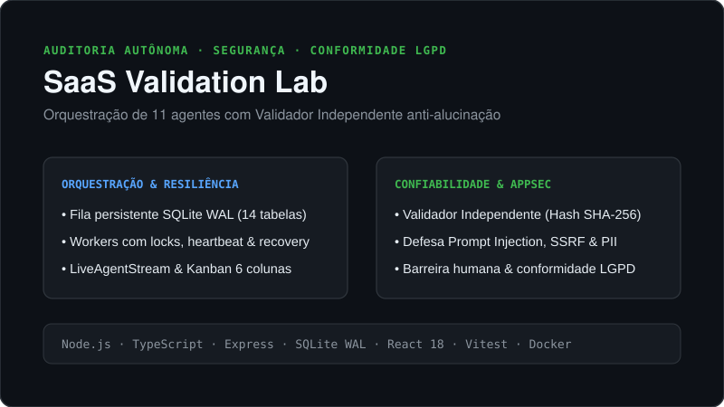

# Estudo de Caso — SaaS Validation Lab (Orquestrador Autônomo de Auditoria, Segurança & Conformidade)

> **Status do repositório:** Privado  
> **Nota de confidencialidade:** este estudo de caso descreve a arquitetura, os mecanismos de confiabilidade e as proteções de segurança do sistema sem expor código-fonte, endereços de infraestrutura, credenciais ou relatórios de alvos internos auditados.

[← Voltar ao Portfólio Principal](../README.md)

---

## 1. Contexto

O **SaaS Validation Lab** é uma plataforma autônoma, visual e persistente construída para auditar aplicações SaaS antes e durante sua operação em produção — reunindo validação de produto, análise de código/arquitetura, QA funcional, segurança ofensiva autorizada, usabilidade e conformidade jurídica (**LGPD**) em um centro de comando unificado.

---

## 2. Problema Identificado

O uso ingênuo de agentes de IA para auditar sistemas costuma falhar em três pontos críticos:
1. **Alucinação e falsos positivos:** modelos geram achados plausíveis na forma, porém sem evidência técnica reproduzível, levando equipes a perder tempo ou tomar decisões erradas de release.
2. **Fragilidade de execução:** scripts dependentes de sessão ativa falham em tarefas longas sem fila persistente, *locks* transacionais ou recuperação após quedas.
3. **Riscos operacionais e de segurança:** executar verificações automatizadas contra aplicações web sem barreiras de escopo expõe o ambiente a *Prompt Injection*, *SSRF* e ações invasivas sem aprovação humana.

---

## 3. Objetivo

Projetar uma plataforma de auditoria multiagente guiada por **governança estrita e evidência verificável**, em que:
- **A IA nunca é tratada como fonte da verdade:** toda descoberta precisa ser auditada por um **Validador Independente** antes de se tornar achado confirmado.
- A execução aconteça em segundo plano de forma resiliente, persistida em banco local com backup a quente.
- Ações sensíveis de segurança ou risco exijam aprovação humana explícita.

---

## 4. Solução Desenvolvida

Foi desenvolvido um monorepo TypeScript (`server` + `client`) composto por API REST, **Orquestrador Daemon**, **Worker Autônomo em background**, catálogo de **11 agentes especializados** e SPA visual de 10 telas:
- **Persistência resiliente:** `node:sqlite` nativo em modo **WAL** com **14 tabelas relacionais**, fila persistente de jobs, *locks* transacionais, *heartbeats*, *crash recovery* e *retries* com backoff exponencial.
- **Validação Anti-Alucinação (`Independent Evidence Validator`):** o 11º agente não produz descobertas primárias — seu único papel é auditar as evidências submetidas pelos outros 10 agentes com **hash SHA-256**, classificando cada item em `VALIDATED`, `REJECTED` ou `NEEDS_ADDITIONAL_VERIFICATION`.
- **Segurança & Governança:** mascaramento de segredos na central de integrações, defesas contra *Prompt Injection* e *SSRF*, escopo estrito de ferramentas autorizadas por agente e central de aprovações humanas para ações de risco.

---

## 5. Principais Funcionalidades

- **11 Agentes Especializados sob Contratos Padronizados:**
  1. `Product Discovery Agent`
  2. `Competitive Intelligence Agent`
  3. `Web Recon Agent`
  4. `Market & Growth Agent`
  5. `Code & Architecture Auditor`
  6. `QA, Security & Reliability Agent`
  7. `UX Recon Agent`
  8. `Product Validation & Release Readiness Agent` (`APPROVED`, `APPROVED_WITH_RESERVATIONS`, `BLOCKED`)
  9. `Legal Research Analyst` (fontes oficiais: LGPD — Lei 13.709/2018, Marco Civil da Internet e Lei 13.787/2018)
  10. `Legal & Privacy Compliance Auditor`
  11. `Independent Evidence Validator` *(obrigatório para todas as descobertas)*
- **Centro de Comando Visual (10 Telas):** Dashboard executivo com score dinâmico de maturidade, gestão de Projetos, Kanban persistido de 6 colunas com resolução de dependências, Checklist de implantação (18 categorias exigindo evidência), Execuções, **LiveAgentStream** (telemetria ao vivo), Integrações (adaptadores PentAGI e Telegram com segredos mascarados), Relatórios (exportação Markdown/JSON), Aprovações Humanas e Diagnósticos.

---

## 6. Tecnologias Utilizadas

| Camada | Tecnologias Comprovadas |
| :--- | :--- |
| **Backend & Orquestração** | Node.js, TypeScript 5.7, Express 4, `node:sqlite` (modo WAL), Zod, Helmet, CORS |
| **Frontend (SPA)** | React 18, Vite 6, Tailwind CSS, Lucide React |
| **Testes & Qualidade** | Vitest (testes unitários e de integração) |
| **Infraestrutura** | Monorepo npm workspaces, Docker, Docker Compose e Coolify |

---

## 7. Arquitetura (Nível Conceitual Autorizado)

```text
[ Centro de Comando SPA (React 18 · 10 Telas · LiveAgentStream) ]
                               │
                               ▼
┌──────────────────────────────────────────────────────────────┐
│          API REST Express + Segurança (Zod / Helmet)         │
│    • Central de Aprovações Humanas • Mascaramento Segredos   │
└──────────────────────────────────────────────────────────────┘
                               │
                               ▼
┌──────────────────────────────────────────────────────────────┐
│    Orquestrador Daemon + Worker Autônomo (SQLite WAL 14T)    │
│    • Locks Transacionais • Heartbeats • Crash Recovery       │
└──────────────────────────────────────────────────────────────┘
                               │
          ┌────────────────────┴────────────────────┐
          ▼                                         ▼
[ 10 Agentes Especializados ] ──► [ Independent Evidence Validator ]
(Recon, Código, QA, UX, LGPD)      Hash SHA-256 · Origem Rastreável
                                   VALIDATED | REJECTED | RETEST
```

---

## 8. Visão Arquitetural



---

## 9. Resultados Comprováveis

- **Implementação verificada:** matriz interna (`IMPLEMENTATION_STATUS.md`) documenta os **20 componentes centrais** como implementados e testados, separando explicitamente dependências externas que exigem credenciais (PentAGI e Telegram).
- **Suíte automatizada:** **11 testes automatizados em Vitest** validando núcleo de banco, fila, segurança e contratos do orquestrador.
- **Documentação canônica:** 17 documentos técnicos estruturados cobrindo arquitetura, contratos de agentes, máquina de estados do orquestrador, modelo de ameaças, banco de dados, operações/backup e conformidade legal.

---

## 10. Link para Demonstração

- **Demonstração / Site:** ferramenta interna de engenharia mantida em ambiente privado (sem exposição pública por razões de segurança operacional).

---

[← Voltar ao Portfólio Principal](../README.md)
