

# 🏎️ Vulpto — SaaS Multi-tenant para Estética Automotiva & Detailing

**Vistoria 3D interativa, Kanban de pátio ao vivo, preços por porte veicular, DRE gerencial real e CRM de retenção.**

  
  
  
  
  

  
  
  
  

[← Voltar ao Portfólio Principal](../README.md) • [🌐 Acessar Plataforma](https://vulpto.duckdns.org/) • [📸 Tour pelos Módulos](#-tour-pelos-módulos-prints-reais) • [🧠 Arquitetura](#-arquitetura-multi-tenant--rbac)

> **Nota de confidencialidade:** produto comercial de código privado. Todos os prints foram capturados em ambiente real de demonstração sem exposição de dados de clientes.

---

## 💡 O Desafio

Estúdios de detailing e lava-jatos especializados costumam perder margem em três frentes: **risco jurídico na recepção** (sem prova fotográfica de riscos prévios), **pátio caótico** sem controle de boxes/comissões e **cegueira financeira** sobre o lucro líquido real depois de insumos químicos, descontos e despesas fixas. O **Vulpto** resolve a operação de ponta a ponta em **19 módulos integrados**.

---

## 📸 Tour pelos Módulos (Prints Reais)

### 1. Landing Page SaaS & Dashboard Executivo
Apresentação comercial com simulador interativo de vistoria 3D e painel gerencial ao vivo exibindo ocupação do pátio, faturamento, ticket médio, despesas e lucro líquido real.

<table>
  <tr>
    <td align="center" width="50%">
      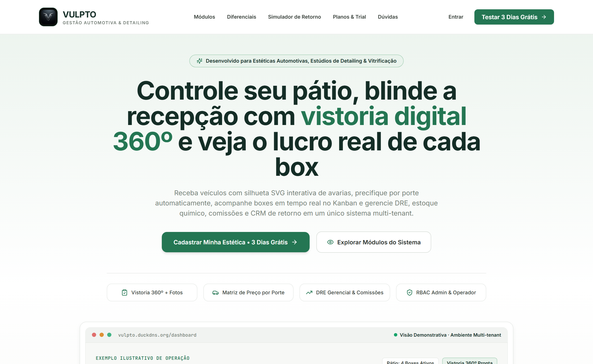 
      <strong>Landing Page SaaS</strong> 
      <code>https://vulpto.duckdns.org/</code>
    </td>
    <td align="center" width="50%">
      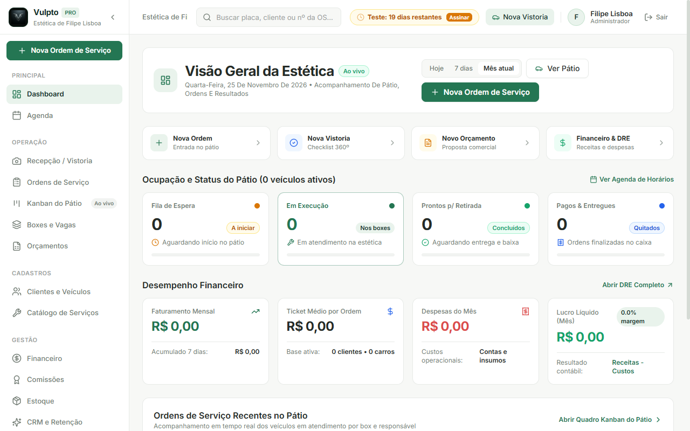 
      <strong>Visão Geral da Estética</strong> 
      Ocupação de boxes, faturamento e margem líquida
    </td>
  </tr>
</table>

---

### 2. Operação de Pátio: Vistoria 360º, Kanban ao Vivo & Ordens de Serviço
Fluxo completo de entrada do veículo: checklist fotográfico com mapeamento de avarias, quadro **Kanban Drag & Drop** por etapa ou box físico e controle rigoroso de Ordens de Serviço.

<table>
  <tr>
    <td align="center" width="50%">
      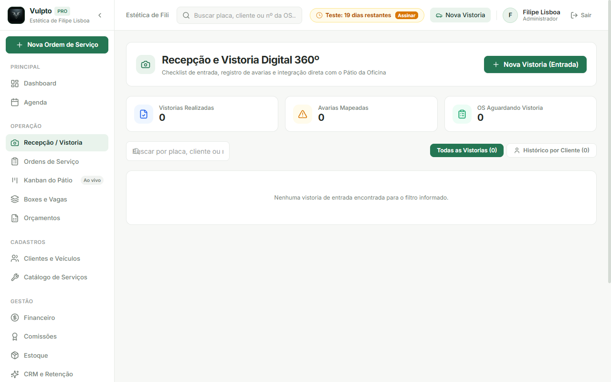 
      <strong>Recepção &amp; Vistoria Digital 360º</strong> 
      Checklist de entrada, fotos e registro de avarias
    </td>
    <td align="center" width="50%">
      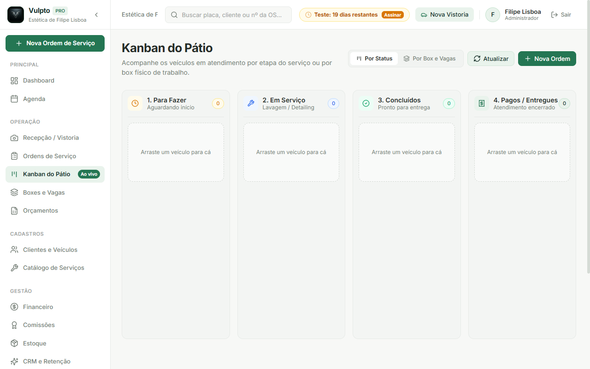 
      <strong>Kanban do Pátio ao Vivo</strong> 
      Para Fazer → Em Serviço → Concluídos → Pagos
    </td>
  </tr>
  <tr>
    <td align="center" width="50%">
      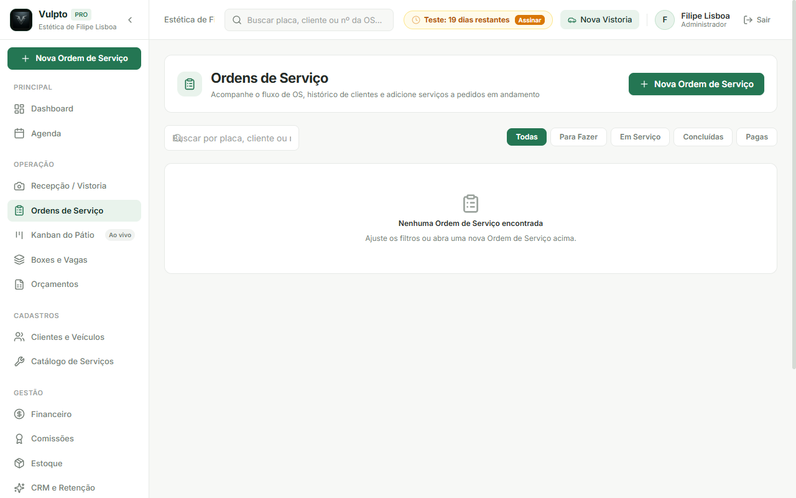 
      <strong>Ordens de Serviço</strong> 
      Congelamento histórico de preços e PDF vetorial
    </td>
    <td align="center" width="50%">
      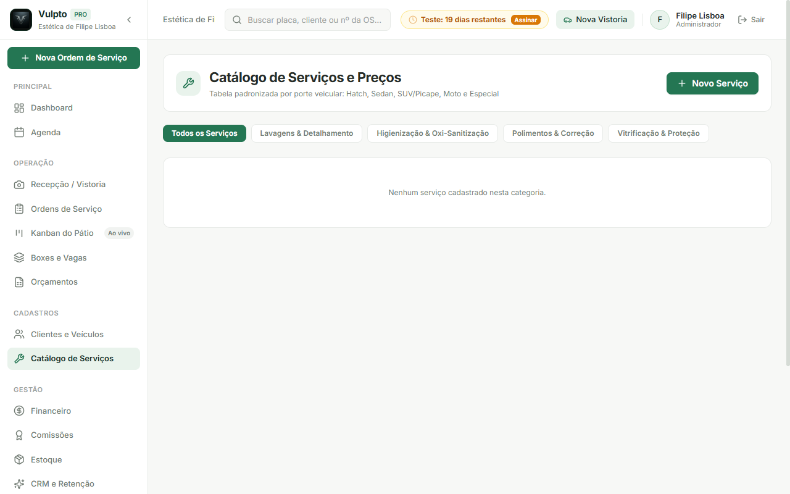 
      <strong>Catálogo &amp; Preços por Porte</strong> 
      Hatch, Sedan, SUV/Picape, Moto e Utilitário
    </td>
  </tr>
</table>

---

### 3. Gestão Estratégica: DRE em Tempo Real, Estoque Químico & CRM de Retenção
Visibilidade contábil real (Receita Bruta → Custos Variáveis → Despesas Fixas → **Lucro Líquido**), controle de químicos com custo médio ponderado e CRM inteligente (dias de chuva, alerta de churn 45d+ e Curva ABC).

<table>
  <tr>
    <td align="center" width="33%">
      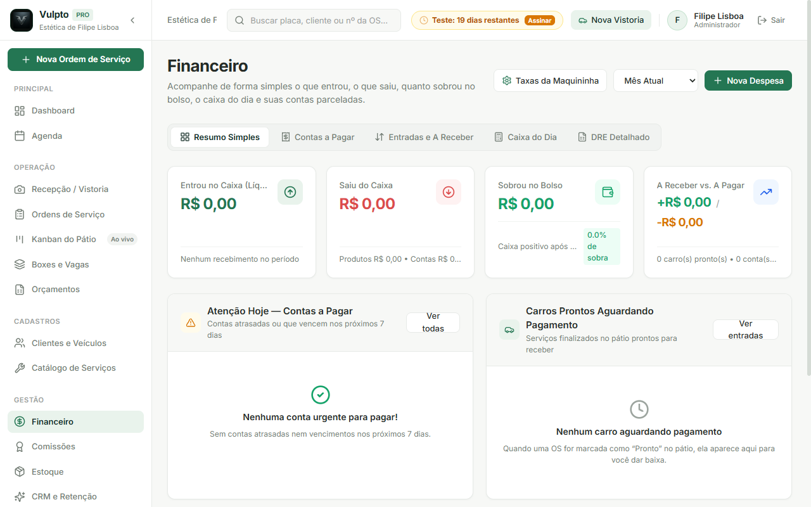 
      <strong>Financeiro &amp; DRE Real</strong> 
      Margem líquida e contas a pagar
    </td>
    <td align="center" width="33%">
      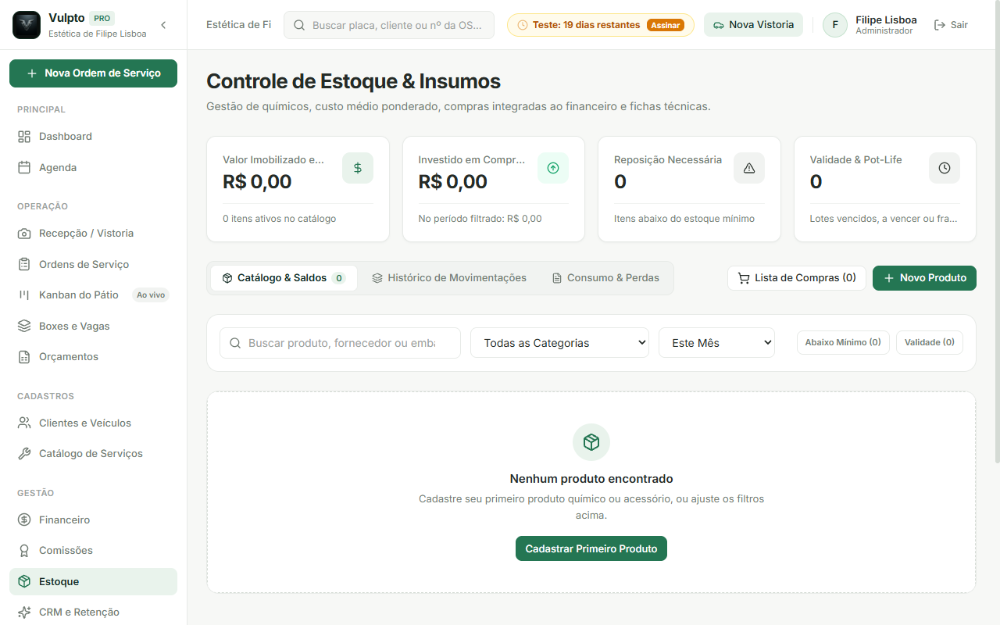 
      <strong>Estoque Químico</strong> 
      Custo médio e alerta de mínimo
    </td>
    <td align="center" width="33%">
      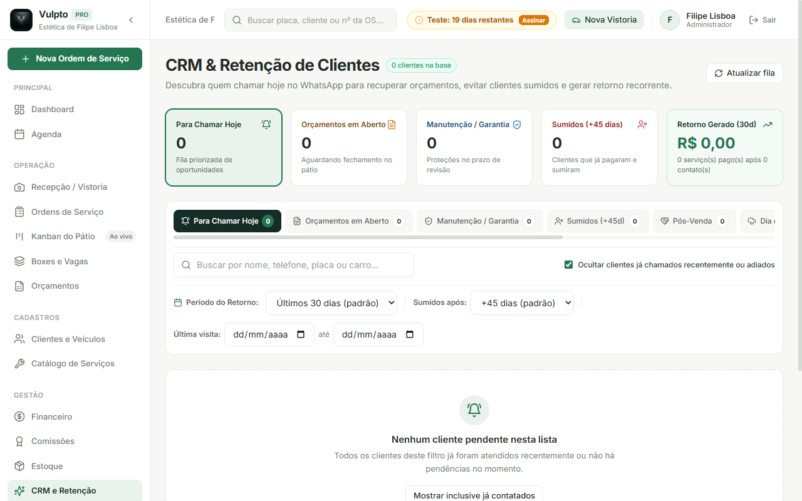 
      <strong>CRM &amp; Retenção Ativa</strong> 
      Curva ABC, dias de chuva e churn 45d+
    </td>
  </tr>
</table>

---

### 📱 Experiência Mobile (Pátio, Dashboard & Vistoria 3D no Celular)

<table>
  <tr>
    <td align="center" width="25%">
       
      <strong>Home Mobile</strong>
    </td>
    <td align="center" width="25%">
       
      <strong>Vistoria 3D no Celular</strong>
    </td>
    <td align="center" width="25%">
      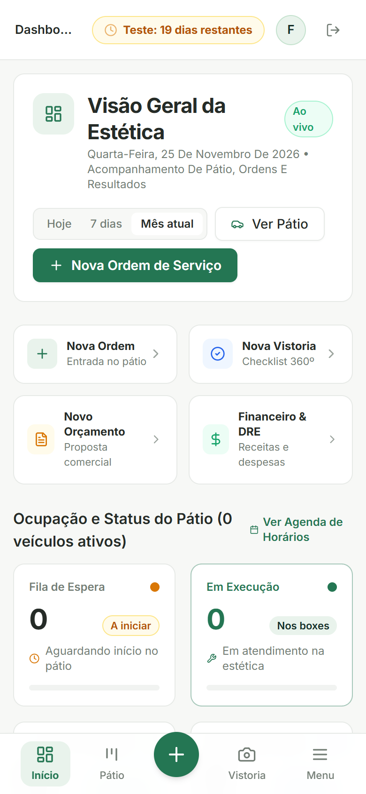 
      <strong>Dashboard Mobile</strong>
    </td>
    <td align="center" width="25%">
      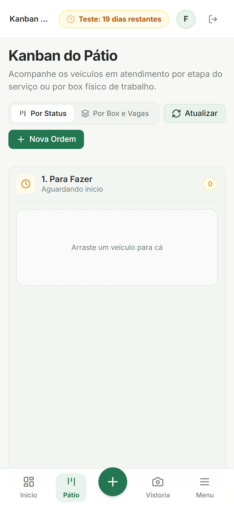 
      <strong>Kanban Mobile</strong>
    </td>
  </tr>
</table>

---

## 🧠 Arquitetura Multi-tenant & RBAC

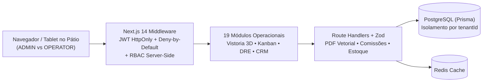

<strong>🛠️ Stack Completa & Validação de Qualidade</strong>

- **Frontend:** Next.js 14 (App Router), React 18, TypeScript 5.6, Tailwind CSS, Framer Motion, Three.js (`@react-three/fiber` + `@react-three/drei`) e Lucide React.
- **Backend & Segurança:** Next.js Route Handlers, Zod, JWT (`jose`) em Cookies `HttpOnly`, Google OAuth2 PKCE, `timingSafeEqual`, `jsPDF` + `jspdf-autotable` e Nodemailer.
- **Qualidade:** suíte automatizada cobrindo autenticação, RBAC (`ADMIN` vs `OPERATOR`), vistorias, OS, financeiro e auditoria mobile (**43/43 asserções aprovadas**).

---

  <a href="https://vulpto.duckdns.org/"><strong>🌐 Acessar Vulpto em Produção</strong></a> &nbsp;•&nbsp; <a href="../README.md"><strong>← Voltar ao Portfólio Principal</strong></a>

