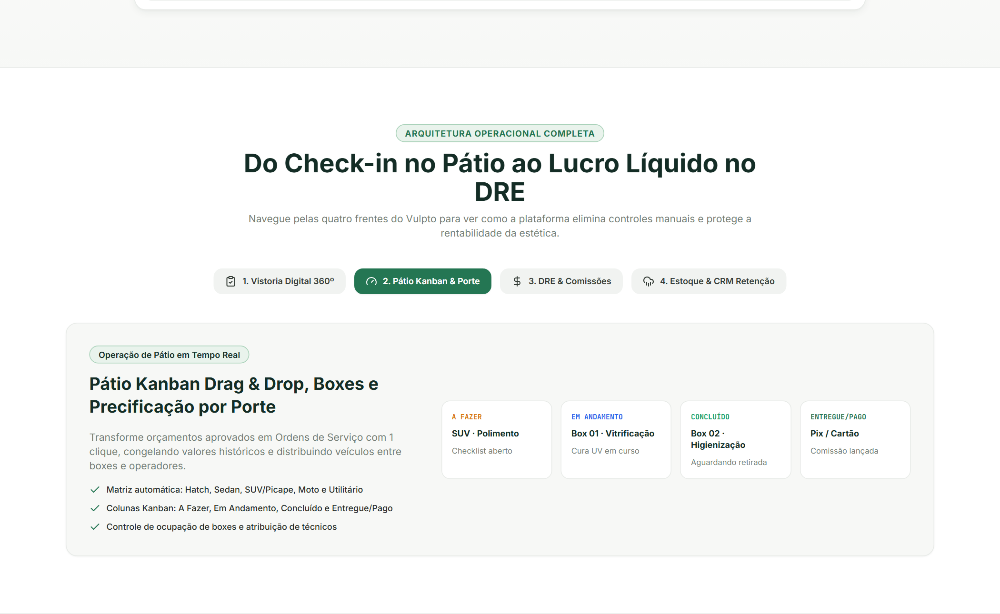
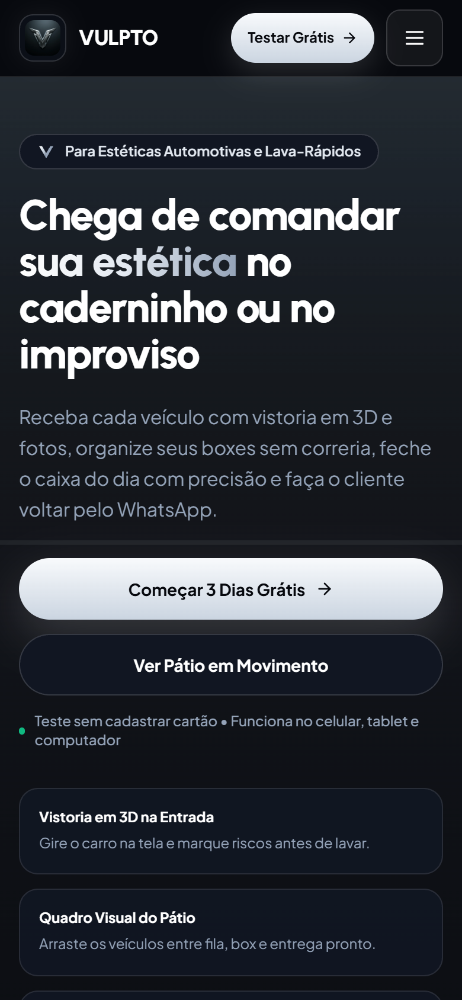
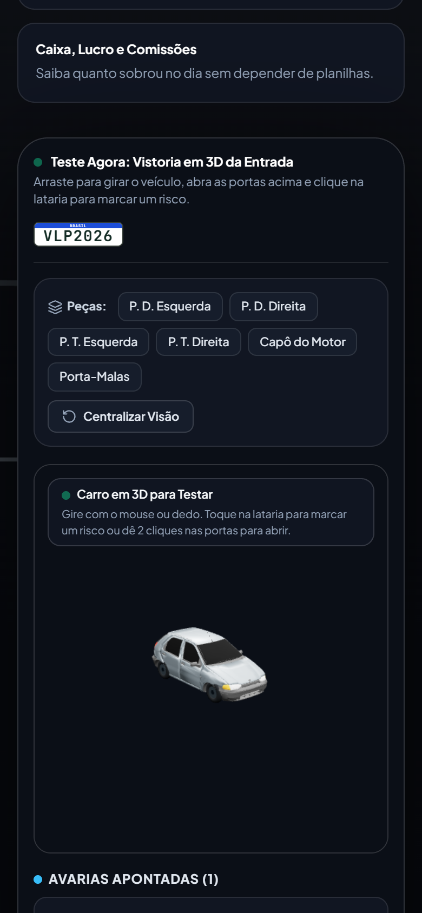

# Estudo de Caso — Vulpto (SaaS Multi-tenant para Estética Automotiva & Detailing)

> **Status do repositório:** Privado (Produto Comercial)  
> **Nota de confidencialidade:** este estudo de caso descreve o produto, suas regras de negócio e sua arquitetura em nível conceitual autorizado, sem expor código-fonte proprietário, credenciais ou dados de clientes.

[← Voltar ao Portfólio Principal](../README.md)

---

## 1. Contexto

O **Vulpto** é uma plataforma SaaS Multi-tenant desenvolvida sob medida para o segmento de **estética automotiva, estúdios de detailing, lava-jatos especializados e centros de vitrificação**. O produto cobre o ciclo operacional, comercial e financeiro completo de uma estética automotiva em uma única interface web.

---

## 2. Problema Identificado

Estúdios de estética automotiva frequentemente enfrentam dores operacionais diretas no dia a dia:
- **Risco jurídico na recepção:** ausência de vistoria estruturada e registro fotográfico de avarias prévias (riscos, amassados, trincas) ao receber o veículo.
- **Precificação inconsistente:** dificuldade em ajustar valores de serviços conforme o porte do veículo (Hatch, Sedan, SUV/Picape, Moto, Utilitário).
- **Descontrole de pátio e equipe:** falta de visibilidade do andamento de cada box, status de Ordens de Serviço e apuração de comissões por operador.
- **Cegueira financeira e de estoque:** desconhecimento do lucro líquido real após descontos, insumos químicos consumidos, comissões e despesas fixas, além de ausência de régua de retorno para clientes antigos.

---

## 3. Objetivo

Construir um sistema de gestão vertical completo sob o princípio de engenharia de **não simular funcionalidades**: todas as telas, vistorias, cálculos de DRE, baixas de estoque químico, apurações de comissão e regras de retenção operam com persistência relacional real, validação estrita e separação de permissões por perfil.

---

## 4. Solução Desenvolvida

Foi implementada uma aplicação full-stack em **Next.js 14 (App Router)** com **TypeScript**, **Prisma ORM** e **PostgreSQL**, estruturada em **19 módulos de dashboard** com isolamento multi-tenant por `tenantId`, middleware *deny-by-default* e controle de acesso baseado em papéis (**RBAC**):
- **`ADMIN`:** visão irrestrita do negócio, DRE gerencial, despesas, liquidação de comissões, estoque e CRM.
- **`OPERATOR`:** acesso estritamente operacional (pátio, boxes, vistoria, ordens de serviço e extrato próprio de comissões), com bloqueio no servidor para dados financeiros confidenciais da empresa.

---

## 5. Principais Funcionalidades

1. **Multi-tenancy, Onboarding & Segurança:** cadastro independente de estéticas, sessões via JWT (`jose`) em Cookies `HttpOnly`, Google OAuth2 PKCE e painel administrativo isolado com comparação em tempo constante (`timingSafeEqual`).
2. **Clientes & Veículos por Porte:** histórico completo por placa e classificação técnica de porte veicular (Hatch/Pequeno, Sedan/Médio, SUV/Picape, Moto e Utilitário Especial).
3. **Catálogo & Matriz de Preços Dinâmica:** escalonamento automático de preços por porte do veículo, tempo estimado de execução e alíquota de comissão por serviço.
4. **Recepção & Vistoria Digital 360º:** silhueta veicular interativa em SVG para marcação de avarias por região (frente, traseira, laterais, teto, vidros), slider de nível de combustível, registro de pertences, upload de fotos e envio de documento via deep link para WhatsApp.
5. **Orçamentos em PDF Vetorial & Pátio Kanban:** geração de propostas (`jsPDF`), congelamento histórico de preços na conversão para Ordem de Serviço e quadro **Kanban Drag & Drop** em tempo real (`A Fazer`, `Em Andamento`, `Concluído`, `Entregue/Pago`) integrado à gestão de boxes.
6. **DRE Gerencial em Tempo Real & Contas a Pagar:** cálculo automático de Receita Bruta → Receita Líquida → Custos Variáveis (insumos e comissões) → Lucro Bruto → Despesas Fixas → **Lucro Líquido Real e margem percentual**.
7. **Comissões & Estoque Químico:** extrato individual e liquidação em lote com lançamento automático no fluxo de caixa; controle de insumos (shampoos, boinas, polidores, ceras, vitrificadores) com alerta de estoque mínimo e movimentações auditáveis.
8. **CRM Inteligente & Retenção Ativa:** gatilho de campanhas para **dias de chuva** (serviços internos), alerta de **churn (45+ dias sem retorno)**, acompanhamento semestral de **revisão de vitrificação**, pós-venda (24h–48h) e classificação automática por **Curva ABC**.

---

## 6. Tecnologias Utilizadas

| Camada | Tecnologias Comprovadas |
| :--- | :--- |
| **Frontend & UI** | Next.js 14 (App Router), React 18, TypeScript 5.6, Tailwind CSS, Framer Motion, Three.js / `@react-three/fiber` / `@react-three/drei`, Lucide React |
| **Backend & APIs** | Next.js Route Handlers, validação Zod, JWT (`jose`) + Cookies `HttpOnly`, Google OAuth2 PKCE, Bcrypt, `jsPDF` + `jspdf-autotable`, Nodemailer |
| **Banco de Dados & Cache** | PostgreSQL (produção) / SQLite (desenvolvimento) via Prisma ORM 5, Redis (`ioredis`) |
| **Qualidade & Deploy** | Playwright, suíte automatizada de testes de integração por fase, Docker e Coolify |

---

## 7. Arquitetura (Nível Conceitual Autorizado)

```text
[ Navegador (ADMIN / OPERATOR) ]
               │
               ▼
┌──────────────────────────────────────────────┐
│ Next.js 14 App Router + Middleware Security  │
│ • Autenticação JWT HttpOnly (Deny-by-Default)│
│ • RBAC no servidor + Escopo por tenantId     │
└──────────────────────────────────────────────┘
               │
      ┌────────┴────────┐
      ▼                 ▼
[ 19 Módulos UI ]  [ Route Handlers & Serviços ]
• Vistoria SVG     • Motor de Preços por Porte
• Kanban & Boxes   • Apuração de DRE & Comissões
• Financeiro / CRM • Estoque Químico & PDF
               │
      ┌────────┴────────┐
      ▼                 ▼
[ PostgreSQL (Prisma) ] [ Redis / Armazenamento ]
```

---

## 8. Capturas Reais (Desktop & Mobile) & Identidade Visual

### 💻 Versão Desktop (`https://vulpto.duckdns.org/`)
<table>
  <tr>
    <td align="center" width="50%">
      <br/>
      <strong>Página Inicial Pública</strong><br/>
      <sub>Apresentação do produto e onboarding SaaS</sub>
    </td>
    <td align="center" width="50%">
      <br/>
      <strong>Showcase Interativo</strong><br/>
      <sub>Pátio Kanban e matriz de preços por porte</sub>
    </td>
  </tr>
</table>

### 📱 Versão Mobile (Responsivo + Vistoria 3D Interativa)
<table>
  <tr>
    <td align="center" width="50%">
      <br/>
      <strong>Home Mobile</strong><br/>
      <sub>Experiência mobile para celular e tablet no pátio</sub>
    </td>
    <td align="center" width="50%">
      <br/>
      <strong>Vistoria 3D Interativa no Celular</strong><br/>
      <sub>Marcação de avarias em modelo 3D (Three.js)</sub>
    </td>
  </tr>
</table>

### Visão Resumida do Produto e Módulos


---

## 9. Resultados Comprováveis

- **Escopo funcional entregue:** 7 fases de implementação concluídas cobrindo 19 módulos operacionais, financeiros e de CRM integrados, além de Página Inicial SaaS pública em `/` com showcase interativo, simulador operacional e onboarding instantâneo integrado ao endpoint de registro multi-tenant.
- **Validação automatizada:** suíte de verificação automatizada cobrindo fluxos ponta a ponta (autenticação, RBAC, vistorias, OS, financeiro e auditoria mobile) com **43/43 asserções aprovadas** conforme documentação técnica interna do projeto (`PROJECT_STATUS.md`).
- **Documentação estruturada:** 12 documentos técnicos dedicados cobrindo arquitetura, design system, RBAC/segurança, rotas/APIs e relatórios de QA.

---

## 10. Link para Demonstração

- **Plataforma e Landing Page em Produção:** [https://vulpto.duckdns.org/](https://vulpto.duckdns.org/)

---

[← Voltar ao Portfólio Principal](../README.md)
